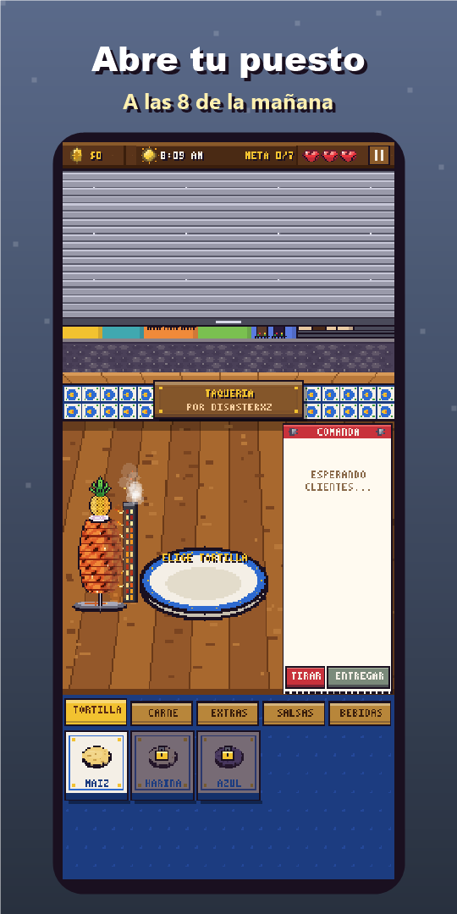
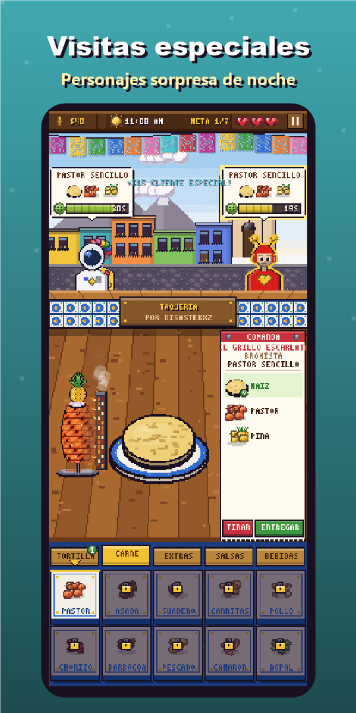
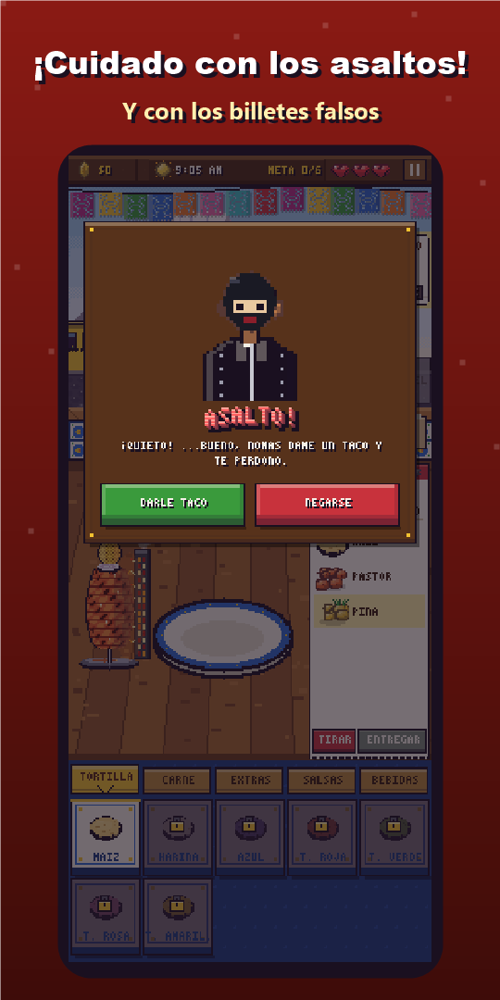
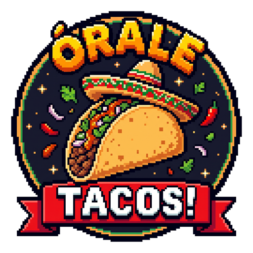

  

  

  
  
  
  
  
  

<b>Abre tu puesto a las 8 de la mañana, atiende a la clientela más chida de México y cierra a las 11 de la noche con la caja llena.</b>

---

## 🌮 ¿Qué es ¡Órale Tacos!?

**¡Órale Tacos!** es un juego de cocina rápida hecho **pixel por pixel**, inspirado en los puestos callejeros de México. Empiezas con una taquería humilde que solo sabe hacer **tacos de pastor sencillos**, y con lo que vendes vas comprando ingredientes, abriendo puestos nuevos y llenando tu barrio de clientes con personalidad: charros, catrinas, luchadores, abuelitas, mariachis, chefs y muchos más.

Cada cliente llega con su pedido, te habla, se desespera si tardas y te deja propina si lo atiendes bien. ¿Te equivocas? Le devuelves su dinero y pagas multa. ¿Tiras un taco? Pierdes los ingredientes. Como en la vida real, mi buen.

---

## 📸 Capturas

<table>
  <tr>
    <td></td>
    <td></td>
    <td></td>
  </tr>
  <tr>
    <td></td>
    <td></td>
    <td></td>
  </tr>
  <tr>
    <td></td>
    <td></td>
    <td></td>
  </tr>
  <tr>
    <td></td>
    <td></td>
    <td></td>
  </tr>
</table>

---

## ✨ Lo que vas a encontrar

| | |
|---|---|
| 🏪 **23 puestos** | Taquería, tamalería, tortería, mariscos, nevería, raspados, dulcería, dulces de feria y muchos más. |
| 📖 **447 recetas** | Desde un taco de pastor en tortilla de colores hasta una torta cubana, pan de muerto o ponche navideño. |
| 🧾 **Comanda guiada** | Cada pedido viene con su lista de ingredientes. las flechas te dicen qué falta y la pestaña cambia sola al siguiente paso. |
| 🗣️ **Clientes que hablan** | Más de 150 frases bien mexicanas: amables, apurados, exigentes, bromistas, norteños, chilangos, tiernos, fresas y tímidos. |
| 🕗 **Un día completo** | el cielo pasa de la mañana al atardecer y a la noche. A las 11 PM se baja la cortina. |
| 💰 **Economía real** | Precios de la calle (taco a $8). Ganas por ventas y propinas, pierdes si tiras o te equivocas, y cada noche pagas la renta del local. |
| 🛒 **Tienda** | Compra puestos, ingredientes, nuevos clientes y ropa para tu clientela. |
| 🎯 **690 niveles** | 30 niveles por puesto en fácil, intermedio y difícil. ¡Complétalos en las tres dificultades para **platinarlos** y ganar un bono! |
| 📅 **Calendario mexicano** | el juego cambia según la fecha: Reyes, Amor y Amistad, Primavera, Día del Niño, Día de las Madres, Día del Maestro, Fiestas Patrias, Halloween, Día de Muertos, Revolución y Navidad, con decoración, música, personajes y platillos de temporada. |
| 🚨 **Eventos sorpresa** | Asaltos (¡hasta se pueden robar el trompo!), billetes falsos que revisas con el plumón detector y patrullas que llegan a ayudarte. |
| 🧔 **Don Chencho** | Un señor sin hogar que te pide un taquito. Si le ayudas, un día te lo paga. Tu **bondad** queda marcada. |
| 💵 **Billetes y monedas** | Tus clientes pagan con billetes y monedas mexicanas y ves el cambio. ¡Favor de traer cambio! |
| 🦗 **Visitas especiales** | Personajes misteriosos que aparecen sobre todo antes de cerrar... ¿los reconoces? |
| 🎨 **Pixel art animado** | Trompo de pastor girando con su piña y su fuego, vaporeras, ollas de barro, comales, garrafas y más. |
| 💡 **Consejos** | Tips cortos que aparecen sin interrumpir la partida. |
| 📱 **Pantalla completa** | Se adapta a cualquier teléfono o tablet, siempre en vertical. |

---

## 🗺️ Los 23 puestos

Cada puesto tiene su propio escenario, utilería animada, barra, clientela y recetas. Toca un puesto para ver todo lo que vende.

| Categoría | Puestos |
|---|---|
| 🍽️ Comida | 🌮 Taquería · 🌽 Tamalería · 🍲 Pozolería · 🥟 Antojitos · 🥖 Tortería · 🥩 Carnitas · 🍜 Birriería · 🍗 al Carbón · 🌭 Jochos y Burgers · 🦐 Mariscos |
| 🍿 Botanas | 🌽 Elotero · 🥨 Botanero · 🍉 Frutería |
| 🍰 Postres | 🍠 Camotero · 🍩 Churrería · 🥐 Pan de Canasta · 🧇 Marquesitas · 🍦 Nevería · 🍧 Raspados · 🍭 Dulces de Feria · 🍬 Dulcería |
| 🥤 Bebidas | 🍹 Aguas Frescas · 🥕 Jugos y Licuados |

### 🍽️ Comida (10 puestos)

<b>🌮 Taquería</b> — 52 recetas · de $8 a $10 · puesto inicial

El puesto con el que empiezas. Trompo de pastor girando con su piña y su fuego, tortillas de maíz, harina, azul y de colores, carnes, verduras, salsas y aguas.

**Ingredientes:**

- **Tortilla:** Maíz, Harina, Azul, T. Roja, T. Verde, T. Rosa, T. Amarilla
- **Carne:** Pastor, Asada, Suadero, Carnitas, Pollo, Chorizo, Barbacoa, Pescado, Camarón, Nopal
- **Extras:** Cebolla, Cilantro, Piña, Limón, Rábano, Pepino, Queso, Guacamole, Frijoles, Col
- **Salsas:** Verde, Roja, Habanero, Pico, Chipotle, Crema
- **Bebidas:** Horchata, Jamaica, Tamarindo, Limonada, Refresco, Naranjada, Mineral

**Recetas:**

| Platillo | Precio |
|---|---|
| Pastor Sencillo | $8 |
| Asada Sencilla | $8 |
| Suadero | $9 |
| Carnitas con Pico | $8 |
| Chorizo con Queso | $8 |
| Gringa | $8 |
| Nopal Vegetariano | $8 |
| Pescado Sencillo | $8 |
| Barbacoa Enchilada | $8 |
| Pollo Chipotle | $8 |
| Pastor Clásico | $9 |
| Asada Callejera | $9 |
| Campechano | $9 |
| Suadero con Todo | $9 |
| Carnitas Michoacanas | $9 |
| Carnitas con Guacamole | $8 |
| Pollo Asado | $8 |
| Pollo Sencillo | $9 |
| Chorizo Callejero | $9 |
| Barbacoa Hidalguense | $9 |
| Taco Baja | $9 |
| Camarón Chipotle | $8 |
| Gobernador | $8 |
| Nopal con Frijol | $8 |
| Azul de Asada | $8 |
| Azul de Barbacoa | $8 |
| Azul de Carnitas | $8 |
| Pastor Norteño | $9 |
| Pastor Picosito | $8 |
| Asada con Frijoles | $8 |
| Asada Norteña | $8 |
| Suadero Azul | $9 |
| Mar y Tierra | $8 |
| Pollo con Frijoles | $8 |
| Campechano Azul | $9 |
| Pescado Azul | $8 |
| Carnitas con Verdura | $9 |
| con Todo Joven | $10 |
| Pastor con Horchata | $9 |
| Asada y Refresco | $9 |
| Suadero con Jamaica | $9 |
| Baja con Limonada | $9 |
| Carnitas y Tamarindo | $8 |
| Gringa con Naranjada | $9 |
| Camarón con Mineral | $9 |
| Pastor en Tortilla Roja | $9 |
| Nopal en Tortilla Verde | $8 |
| Pollo en Tortilla Rosa | $8 |
| Asada en Tortilla Amarilla | $9 |
| Suadero Rojo | $9 |
| Camarón en Tortilla Verde | $8 |
| Taco Arcoíris | $9 |

<b>🌽 Tamalería</b> — 23 recetas · de $15 a $17 · se desbloquea con $900

Vaporera humeante con tamales verdes, rojos, de rajas, mole, oaxaqueños, dulces, de frijol y de elote. Guajolotas y atoles calientitos.

**Ingredientes:**

- **Base:** Plato, Bolillo
- **Tamales:** Verde, Rojo, Rajas, Mole, Dulce, Oaxaqueño, Frijol, Elote
- **Atoles:** Champurrado, Arroz, Fresa, Vainilla, Café Olla, Nuez, Guayaba, Chocolate
- **Extras:** Crema, Queso, Verde, Roja

**Recetas:**

| Platillo | Precio |
|---|---|
| Tamal Verde | $15 |
| Tamal Rojo | $15 |
| Tamal de Mole | $15 |
| Oaxaqueño | $15 |
| Guajolota Verde | $15 |
| Guajolota Roja | $15 |
| Rajas con Crema | $15 |
| Desayuno Dulce | $15 |
| Elote con Crema | $15 |
| Frijol con Queso | $15 |
| Verde y Rojo | $15 |
| Guajolota con Champurrado | $15 |
| Mole con Café de Olla | $15 |
| Elote y Vainilla | $15 |
| Guajolota de Rajas | $15 |
| Oaxaqueño Bañado | $15 |
| Pareja Picosa | $15 |
| Dulce con Champurrado | $15 |
| Trio Mixto | $17 |
| Mole con Chocolate | $15 |
| Guajolota con Atole de Nuez | $15 |
| Dulce con Atole de Guayaba | $15 |
| Rajas con Chocolate | $15 |

<b>🍲 Pozolería</b> — 23 recetas · de $45 a $55 · se desbloquea con $1,400

Olla de barro con pozole rojo, blanco y verde, menudo, pancita, birria, caldo de res, de gallina, tlalpeño y sopa de lima.

**Ingredientes:**

- **Caldo:** Rojo, Blanco, Verde, Menudo, Birria, Res, Tlalpeño, Lima, Gallina
- **Encima:** Lechuga, Rábano, Cebolla, Orégano, Piquín, Limón, Aguacate, Cilantro
- **Al Lado:** Tostada, Crema, Chicharrón, Maíz, Bolillo
- **Bebidas:** Jamaica, Horchata, Limonada, Refresco, Mineral

**Recetas:**

| Platillo | Precio |
|---|---|
| Pozole Rojo Sencillo | $45 |
| Birria Sencilla | $45 |
| Caldo de Res | $45 |
| Menudo Sencillo | $45 |
| Verde con Aguacate | $45 |
| Tlalpeño | $45 |
| Sopa de Lima | $45 |
| Pozole Blanco | $50 |
| Pozole Rojo | $55 |
| Pozole Verde | $50 |
| Menudo Completo | $50 |
| Birria de Jalisco | $50 |
| Caldo de Res Completo | $50 |
| Blanco con Crema | $45 |
| Tlalpeño con Tostada | $45 |
| Rojo con Chicharrón | $45 |
| Pozole con Jamaica | $50 |
| Menudo con Refresco | $45 |
| Birria y Horchata | $45 |
| Caldo de Gallina | $50 |
| Gallina Completo | $50 |
| Pancita | $50 |
| Pancita Sencilla | $45 |

<b>🥟 Antojitos</b> — 29 recetas · de $15 a $19 · se desbloquea con $1,800

Comal con quesadillas al comal y fritas, gorditas, sopes, huaraches, tlacoyos, molotes, empanadas, flautas y tacos dorados.

**Ingredientes:**

- **Base:** Comal, Frita, Gordita, Sope, Huarache, Tlacoyo, Molote, Empanada, Flauta, Dorado
- **Relleno:** Papa, Tinga, Flor Calab., Champiñón, Prensado, Sesos, Picadillo, Requesón, Frijoles, Haba
- **Carnes:** Pollo, Res, Barbacoa, Chorizo, Quesillo
- **Encima:** Crema, Queso, Lechuga, Cebolla, Cilantro, Nopal, Guacamole, Verde, Roja, Pico

**Recetas:**

| Platillo | Precio |
|---|---|
| Quesadilla de Papa | $15 |
| Quesadilla de Tinga | $15 |
| Quesadilla de Flor | $15 |
| Quesadilla de Champiñones | $15 |
| Quesadilla de Chicharrón | $15 |
| Quesadilla Sola | $15 |
| Quesadilla de Sesos | $17 |
| Frita de Papa | $17 |
| Frita de Picadillo | $17 |
| Gordita de Chicharrón | $17 |
| Gordita de Requesón | $15 |
| Sope Sencillo | $17 |
| Sope de Pollo | $19 |
| Sope de Chorizo | $17 |
| Huarache de Chorizo | $17 |
| Huarache de Nopales | $17 |
| Tlacoyo de Frijol | $17 |
| Tlacoyo de Haba | $17 |
| Tlacoyo de Requesón | $17 |
| Molotes de Papa | $17 |
| Molotes de Tinga | $17 |
| Empanada de Picadillo | $15 |
| Empanada de Tinga | $15 |
| Flautas de Pollo | $17 |
| Flautas de Res | $17 |
| Flautas de Papa | $17 |
| Dorados de Barbacoa | $17 |
| Dorados de Pollo | $17 |
| Dorados de Papa | $17 |

<b>🥖 Tortería</b> — 16 recetas · de $35 a $43 · se desbloquea con $2,700

Tortas armadas capa por capa: milanesa, pierna, jamón, cubana, suiza, hawaiana, ahogadas, cemitas poblanas y pambazos.

**Ingredientes:**

- **Pan:** Telera, Cemita, Pambazo, Birote
- **Relleno:** Milanesa, Pierna, Jamón, Salchicha, Amarillo, Quesillo, Huevo, Papa Chorizo, Carnitas, Piña
- **Extras:** Jitomate, Cebolla, Aguacate, Jalapeño, Lechuga, Frijoles, Mayonesa, Pápalo, Crema, Queso
- **Salsas:** Ahogada, de Arbol, Chipotle
- **Bebidas:** Refresco, Naranjada, Horchata, Jamaica

**Recetas:**

| Platillo | Precio |
|---|---|
| Torta de Jamón | $39 |
| Torta de Salchicha | $39 |
| Torta de Huevo | $39 |
| Torta de Pierna | $39 |
| Torta de Milanesa | $43 |
| Torta Cubana | $43 |
| Torta Suiza | $39 |
| Torta Hawaiana | $39 |
| Torta Ahogada | $39 |
| Ahogada Media | $35 |
| Cemita Poblana | $39 |
| Cemita de Pierna | $39 |
| Pambazo | $39 |
| Pambazo con Chipotle | $39 |
| Milanesa y Refresco | $39 |
| Suiza con Jamaica | $39 |

<b>🥩 Carnitas</b> — 15 recetas · de $10 a $12 · se desbloquea con $3,000

Cazo de cobre con maciza, cuerito, buche, nana y surtida, por taco, torta o por kilo.

**Ingredientes:**

- **Base:** Maíz, Bolillo, Por Kilo
- **Carne:** Maciza, Cuerito, Buche, Nana, Surtida, Chicharrón
- **Extras:** Cebolla, Cilantro, Limón, Guacamole, Pico, Verde, Roja, Nopal
- **Bebidas:** Refresco, Jamaica, Horchata, Mineral

**Recetas:**

| Platillo | Precio |
|---|---|
| Taco de Maciza | $11 |
| Taco de Cuerito | $11 |
| Taco de Buche | $11 |
| Taco de Nana | $11 |
| Taco Surtido | $11 |
| Surtido con Todo | $12 |
| Maciza con Guacamole | $10 |
| Chicharrón en Salsa | $10 |
| Torta de Carnitas | $11 |
| Torta de Cuerito | $10 |
| Medio Kilo de Maciza | $11 |
| Kilo Surtido | $12 |
| Maciza y Refresco | $11 |
| Buche y Jamaica | $11 |
| Surtido con Horchata | $11 |

<b>🍜 Birriería</b> — 13 recetas · de $12 a $14 · se desbloquea con $3,600

Birria, quesabirrias, barbacoa y consomé bien calientito.

**Ingredientes:**

- **Base:** Maíz, Quesabirria, Consome, Plato
- **Carne:** Birria, Barbacoa, Quesillo
- **Extras:** Cebolla, Cilantro, Limón, Rábano, Roja, Verde, Guacamole
- **Consome:** Consome, Refresco, Jamaica, Horchata

**Recetas:**

| Platillo | Precio |
|---|---|
| Taco de Birria | $13 |
| Quesabirria | $13 |
| Quesabirria con Consome | $13 |
| Quesabirria Picosa | $12 |
| Taco de Barbacoa | $13 |
| Barbacoa con Consome | $13 |
| Consome de Birria | $13 |
| Consome de Barbacoa | $13 |
| Plato de Birria | $14 |
| Plato de Barbacoa | $14 |
| Birria con Guacamole | $12 |
| Barbacoa y Refresco | $13 |
| Quesabirria y Jamaica | $13 |

<b>🍗 al Carbón</b> — 16 recetas · de $60 a $66 · se desbloquea con $4,600

Asador con pollos rostizados y al carbón, alitas, boneless, costillas y parrilladas con sus salsas.

**Ingredientes:**

- **Base:** Rostizado, al Carbón, Alitas, Boneless, Costillas, Parrillada
- **Salsas:** Bufalo, Bbq, Mango Hab., Tamarindo, Lemon Pep.
- **Lado:** Papas, Cebollitas, Maíz, Arroz, Frijoles, Apio Zanah., Aderezo, Roja
- **Bebidas:** Refresco, Naranjada, Mineral, Limonada

**Recetas:**

| Platillo | Precio |
|---|---|
| Pollo Rostizado | $60 |
| Pollo al Carbón | $60 |
| Pollo con Arroz | $60 |
| Pollo y Papas | $60 |
| Alitas Bufalo | $60 |
| Alitas Bbq | $60 |
| Alitas Mango Habanero | $60 |
| Alitas Lemon Pepper | $60 |
| Boneless Bbq | $60 |
| Boneless Bufalo | $60 |
| Boneless de Tamarindo | $60 |
| Costillas Bbq | $60 |
| Costillas al Tamarindo | $60 |
| Parrillada Callejera | $66 |
| Parrillada Completa | $66 |
| Alitas y Refresco | $60 |

<b>🌭 Jochos y Burgers</b> — 15 recetas · de $25 a $31 · se desbloquea con $5,000

Jochos con tocino, hamburguesas al carbón, banderillas y salchipulpos con papas.

**Ingredientes:**

- **Base:** Pan Jocho, Pan Burger, Banderilla, Band. Queso, Salchipulpo
- **Relleno:** Salchicha, Carne, Tocino, Amarillo, Ceb. Asada, Jitomate, Jalapeño, Lechuga, Aguacate, Piña
- **Aderezos:** Catsup, Mostaza, Mayonesa, Salsa, Chipotle
- **Lado:** Papas, Refresco, Naranjada, Mineral

**Recetas:**

| Platillo | Precio |
|---|---|
| Jocho Sencillo | $25 |
| Jocho con Tocino | $31 |
| Jocho Norteño | $31 |
| Jocho Hawaiano | $28 |
| Hamburguesa Sencilla | $28 |
| Hamburguesa con Queso | $28 |
| Hamburguesa con Tocino | $28 |
| Hamburguesa Hawaiana | $28 |
| Hamburguesa al Chipotle | $28 |
| Banderilla de Salchicha | $25 |
| Banderilla de Queso | $25 |
| Salchipulpos con Papas | $25 |
| Salchipulpos Picosos | $25 |
| Combo Jocho | $31 |
| Combo Hamburguesa | $31 |

<b>🦐 Mariscos</b> — 15 recetas · de $44 a $48 · se desbloquea con $6,500

Cocteles de camarón y pulpo, tostadas de ceviche, aguachiles y pescadillas frente al mar.

**Ingredientes:**

- **Base:** Copa, Tostada, Molcajete, Pescadilla
- **Marisco:** Camarón, Ceviche, Pulpo, Pescado
- **Extras:** Ceb. Morada, Pepino, Aguacate, Jitomate, Cilantro, Limón, Mayonesa
- **Salsas:** Coctel, Negra, Verde, Salsa
- **Lado:** Galletas, Tostadas, Mineral, Refresco

**Recetas:**

| Platillo | Precio |
|---|---|
| Coctel de Camarón | $48 |
| Coctel Campechano | $48 |
| Coctel de Pulpo | $44 |
| Coctel Picoso | $44 |
| Coctel con Galletas | $44 |
| Tostada de Ceviche | $48 |
| Tostada de Camarón | $44 |
| Tostada de Pulpo | $44 |
| Tostada Mixta | $44 |
| Ceviche con Tostadas | $44 |
| Aguachile Verde | $44 |
| Aguachile Negro | $44 |
| Aguachile Rojo | $44 |
| Pescadillas | $44 |
| Pescadillas con Aguacate | $44 |

### 🍿 Botanas (3 puestos)

<b>🌽 Elotero</b> — 21 recetas · de $20 a $24 · se desbloquea con $1,100

Carrito elotero: elotes, elotes asados, esquites, trolelotes, chaskas y sopa con esquite.

**Ingredientes:**

- **Base:** Elote, Asado, Esquite, Sopa
- **Encima:** Mayonesa, Crema, Queso, Chile, Limón, Salsa, Sal, Mantequilla, Epazote
- **Extras:** Frituras, Granos, Chamoy, Chilito
- **Bebidas:** Refresco, Naranjada, Tamarindo, Jamaica, Mineral

**Recetas:**

| Platillo | Precio |
|---|---|
| Elote con Limón y Sal | $20 |
| Elote Sencillo | $20 |
| Esquite Sencillo | $20 |
| Asado con Crema | $20 |
| Elote Clásico | $22 |
| Esquite Clásico | $22 |
| Elote Asado | $20 |
| Esquite Picoso | $22 |
| Esquite Cremoso | $20 |
| Esquite de Epazote | $20 |
| Asado con Todo | $22 |
| Elote Preparado | $24 |
| Elote y Refresco | $22 |
| Esquite con Tamarindo | $22 |
| Asado con Naranjada | $20 |
| Trolelote | $22 |
| Trolelote con Limón | $22 |
| Chaska | $24 |
| Chaska con Chilito | $22 |
| Sopa con Esquite | $22 |
| Sopa Preparada | $22 |

<b>🥨 Botanero</b> — 15 recetas · de $25 a $34 · se desbloquea con $3,600

Fritulocos, totolocos, chicharrón de harina preparado, papas con limón y cacahuates japoneses, salados y enchilados.

**Ingredientes:**

- **Base:** Fritura, Totopos, Chicharrón, Papas, Bolsita
- **Picado:** Cueritos, Col, Jícama, Pepino, Aguacate, Queso, Crema, Cebolla
- **Dulces:** Japones, Salados, Enchilados, Gomitas, Gom. Ench., Pepitas
- **Salsas:** Chamoy, Salsa, Limón, Chilito, Sal, Inglesa
- **Bebidas:** Refresco, Mineral, Tamarindo, Jamaica

**Recetas:**

| Platillo | Precio |
|---|---|
| Fritulocos | $31 |
| Fritulocos Dulces | $31 |
| Totolocos | $31 |
| Totolocos con Queso | $28 |
| Chicharrón Preparado | $28 |
| Chicharrón con Todo | $34 |
| Chicharrón Sencillo | $25 |
| Papas con Limón y Salsa | $25 |
| Papas Enchiladas | $25 |
| Papas Preparadas | $28 |
| Cacahuates Japoneses | $25 |
| Cacahuates Salados | $25 |
| Cacahuates Enchilados | $28 |
| Gomitas Enchiladas | $25 |
| Bolsita Mixta | $28 |

<b>🍉 Frutería</b> — 15 recetas · de $25 a $31 · se desbloquea con $2,200

Vasos de fruta con limón, sal y chile, vasos locos con gomitas y chamoy, y cocteles con yogurt, granola y miel.

**Ingredientes:**

- **Vaso:** Vaso, Vaso Loco, Coctel
- **Fruta:** Jícama, Pepino, Mango, Sandía, Piña, Melón, Coco, Fresa, Plátano, Papaya
- **Encima:** Limón, Sal, Piquín, Chamoy, Chilito, Gomitas, Japones, Yogurt, Granola, Miel

**Recetas:**

| Platillo | Precio |
|---|---|
| Vaso de Mango | $25 |
| Vaso de Jícama | $28 |
| Pepino con Chile | $28 |
| Sandía con Limón | $25 |
| Fruta Mixta | $31 |
| Vaso de Coco | $25 |
| Mango con Chamoy | $28 |
| Melón y Papaya | $25 |
| Vaso Loco | $31 |
| Vaso Loco de Mango | $28 |
| Vaso Loco de Sandía | $28 |
| Coctel de Frutas | $31 |
| Coctel con Yogurt | $28 |
| Coctel Tropical | $31 |
| Fresas con Yogurt | $25 |

### 🍰 Postres (8 puestos)

<b>🍠 Camotero</b> — 13 recetas · de $20 a $20 · se desbloquea con $2,400

Carrito camotero con su silbato: camotes y plátanos horneados y plátanos fritos con crema y queso.

**Ingredientes:**

- **Base:** Camote, Plátano, Fritos
- **Encima:** Leche Cond., Mermelada, Crema, Queso, Canela, Azúcar, Cajeta, Miel, Nuez
- **Bebidas:** Café Olla, Champurrado, Chocolate

**Recetas:**

| Platillo | Precio |
|---|---|
| Camote con Leche | $20 |
| Camote con Mermelada | $20 |
| Camote con Todo | $20 |
| Camote con Cajeta | $20 |
| Camote con Miel | $20 |
| Plátano Horneado | $20 |
| Plátano con Mermelada | $20 |
| Plátano con Canela | $20 |
| Plátanos Fritos | $20 |
| Plátanos Fritos Dulces | $20 |
| Plátanos con Todo | $20 |
| Camote y Café de Olla | $20 |
| Plátano y Champurrado | $20 |

<b>🍩 Churrería</b> — 19 recetas · de $12 a $12 · se desbloquea con $3,300

Churros azucarados y rellenos, donas, buñuelos, gorditas de nata, waffles en palo y hot cakes.

**Ingredientes:**

- **Base:** Churro, Relleno, Dona, Buñuelo, G. de Nata, Waffle, Hot Cakes
- **Encima:** Azúcar, Canela, Cajeta, Chocolate, Leche Cond., Mermelada, Avellana, Chispas, Nuez, Miel
- **Bebidas:** Chocolate, Café Olla, Champurrado, Arroz

**Recetas:**

| Platillo | Precio |
|---|---|
| Churros Azucarados | $12 |
| Churro de Cajeta | $12 |
| Churro de Chocolate | $12 |
| Churro de Leche Condensada | $12 |
| Churro de Fresa | $12 |
| Churros con Chocolate | $12 |
| Dona con Chispas | $12 |
| Dona de Chocolate | $12 |
| Dona Espolvoreada | $12 |
| Donas y Café | $12 |
| Buñuelo con Miel | $12 |
| Buñuelo Azucarado | $12 |
| Gorditas de Nata | $12 |
| Nata con Cajeta | $12 |
| Waffle con Chocolate | $12 |
| Waffle de Avellana | $12 |
| Hot Cakes Mini | $12 |
| Hot Cakes con Cajeta | $12 |
| Hot Cakes de Chocolate | $12 |

<b>🥐 Pan de Canasta</b> — 20 recetas · de $10 a $11 · se desbloquea con $4,200

Canasta de pan dulce: conchas, cuernitos, orejas, mantecadas, ojos de buey, garibaldis, pan de feria, pan de muerto y rosca de reyes.

**Ingredientes:**

- **Base:** Charola, Bolsa
- **Pan:** Concha, Concha Ch., Cuernito, Oreja, Mantecada, Ojo Buey, Garibaldi, Feria Nuez, Feria Crema, Dona
- **Temporada:** Pan Muerto, Rosca
- **Bebidas:** Café Olla, Chocolate, Champurrado, Arroz, Vainilla

**Recetas:**

| Platillo | Precio |
|---|---|
| Concha de Vainilla | $10 |
| Concha de Chocolate | $10 |
| Concha con Café | $10 |
| Cuernito con Chocolate | $10 |
| Orejas | $10 |
| Ojo de Buey | $10 |
| Mantecada con Atole | $10 |
| Pan de Feria de Nuez | $10 |
| Pan de Feria de Crema | $10 |
| Pan de Feria con Café | $10 |
| Dona y Champurrado | $10 |
| Merienda Completa | $10 |
| Dos Conchas | $10 |
| Bolsa Surtida | $11 |
| Garibaldis | $10 |
| Desayuno de Canasta | $11 |
| Pan de Muerto | $10 |
| Pan de Muerto con Chocolate | $10 |
| Rosca de Reyes | $10 |
| Rosca con Chocolate | $10 |

<b>🧇 Marquesitas</b> — 16 recetas · de $30 a $33 · se desbloquea con $4,600

Marquesitas con queso de bola y crepas dulces y saladas hechas en la plancha.

**Ingredientes:**

- **Base:** Marquesita, Crepa Dulce, Crepa Sal.
- **Dulce:** Queso Bola, Avellana, Cajeta, Mermelada, Leche Cond., Chocolate, Plátano, Fresa, Nuez, Chispas
- **Salado:** Jamón, Quesillo, Champiñón, Pollo, Espinaca, Granos, Chipotle, Crema
- **Bebidas:** Café Olla, Chocolate, Horchata, Limonada

**Recetas:**

| Platillo | Precio |
|---|---|
| Marquesita de Queso | $30 |
| Marquesita de Avellana | $30 |
| Queso y Avellana | $30 |
| Marquesita de Cajeta | $30 |
| Marquesita de Mermelada | $30 |
| Marquesita de Plátano | $30 |
| Crepa de Fresa | $30 |
| Crepa de Plátano | $30 |
| Crepa de Cajeta y Nuez | $30 |
| Crepa de Chocolate | $30 |
| Crepa de Jamón y Queso | $30 |
| Crepa de Champiñones | $30 |
| Crepa de Pollo | $30 |
| Crepa de Espinaca | $30 |
| Crepa de Elote | $33 |
| Crepa y Café | $30 |

<b>🍦 Nevería</b> — 18 recetas · de $20 a $20 · se desbloquea con $5,400

Nieves de garrafa (limón, mamey, beso de ángel, nuez, queso...), paletas de hielo y esquimales.

**Ingredientes:**

- **Base:** Cono, Vasito, Paleta, Esquimal
- **Sabor:** Nieve Lim., Mamey, Beso Angel, Nuez, Queso, Fresa, Chocolate, Vainilla, Mango, Tamarindo
- **Encima:** Chispas, Nuez, Coco, Chocolate, Cajeta, Chamoy, Chilito, Cereza

**Recetas:**

| Platillo | Precio |
|---|---|
| Nieve de Limón | $20 |
| Nieve de Mamey | $20 |
| Beso de Angel | $20 |
| Nieve de Nuez | $20 |
| Nieve de Queso | $20 |
| Fresa y Vainilla | $20 |
| Napolitano | $20 |
| Mango con Chile | $20 |
| Nieve de Tamarindo | $20 |
| Cono con Chispas | $20 |
| Limón y Mamey | $20 |
| Vasito con Cajeta | $20 |
| Paleta de Limón | $20 |
| Paleta de Fresa | $20 |
| Paleta de Mango Enchilada | $20 |
| Esquimal de Coco | $20 |
| Esquimal de Nuez | $20 |
| Esquimal de Fresa | $20 |

<b>🍧 Raspados</b> — 14 recetas · de $20 a $22 · se desbloquea con $5,800

Raspados de grosella, tamarindo, limón, rompope y más; diablitos y chamoyadas.

**Ingredientes:**

- **Base:** Raspado, Chamoyada
- **Jarabe:** Grosella, Tamarindo, Jarabe. Limón, Rompope, Vainilla, Jarabe. Mango, Fresa, Nanche
- **Encima:** Chamoy, Chilito, Leche Cond., Mango, Gomitas, Tamarindo, Nieve Lim., Limón

**Recetas:**

| Platillo | Precio |
|---|---|
| Raspado de Grosella | $20 |
| Raspado de Tamarindo | $20 |
| Raspado de Limón | $20 |
| Raspado de Rompope | $20 |
| Vainilla con Leche | $20 |
| Fresa con Leche | $20 |
| Raspado de Nanche | $20 |
| Raspado Mixto | $20 |
| Fresa y Mango | $20 |
| Diablito | $22 |
| Diablito con Nieve | $22 |
| Chamoyada de Mango | $22 |
| Chamoyada Loca | $22 |
| Chamoyada de Tamarindo | $22 |

<b>🍭 Dulces de Feria</b> — 21 recetas · de $15 a $15 · se desbloquea con $7,500

Algodones de azúcar, manzanas acarameladas y con chamoy, palomitas, alegrías, palanquetas, pepitorias, arroz con leche, gelatinas, flanes y fresas con crema.

**Ingredientes:**

- **Feria:** Algodón, Alg. Azul, Manzana, Manz. Chamoy, Palomitas, Alegría, Palanqueta, Pepitoria
- **Postre:** Arroz Leche, Gelatina, Flan, Fresas
- **Encima:** Mantequilla, Caramelo, Chilito, Chamoy, Limón, Canela, Crema, Leche Cond., Chispas, Nuez
- **Bebidas:** Refresco, Chocolate, Tamarindo, Horchata

**Recetas:**

| Platillo | Precio |
|---|---|
| Algodón Rosa | $15 |
| Algodón Azul | $15 |
| Manzana Acaramelada | $15 |
| Manzana con Chamoy | $15 |
| Manzana Enchilada | $15 |
| Palomitas de Mantequilla | $15 |
| Palomitas Acarameladas | $15 |
| Palomitas Enchiladas | $15 |
| Palomitas Preparadas | $15 |
| Palomitas y Refresco | $15 |
| Alegría | $15 |
| Palanqueta | $15 |
| Pepitoria | $15 |
| Arroz con Leche | $15 |
| Arroz con Leche y Nuez | $15 |
| Gelatina | $15 |
| Gelatina con Crema | $15 |
| Flan Napolitano | $15 |
| Flan con Caramelo | $15 |
| Fresas con Crema | $15 |
| Fresas con Chispas | $15 |

<b>🍬 Dulcería</b> — 17 recetas · de $10 a $11 · se desbloquea con $2,600

Dulces típicos mexicanos: mazapanes, obleas, cocadas, borrachitos, jamoncillos, glorias, ate, muéganos, tamarindo enchilado y más.

**Ingredientes:**

- **Base:** Bolsita, Charola
- **Dulces:** Mazapán, Oblea, Cocada, Borrachito, Jamoncillo, Gloria, Ate, Muégano, Tamarindo, Paleta
- **Típicos:** Alegría, Palanqueta, Pepitoria, Camote Pob., Cajeta, Calabaza
- **Extras:** Chilito, Chamoy, Limón

**Recetas:**

| Platillo | Precio |
|---|---|
| Bolsita de Mazapanes | $10 |
| Obleas con Cajeta | $10 |
| Cocadas | $10 |
| Borrachitos | $10 |
| Jamoncillos | $10 |
| Glorias | $10 |
| Ate de Membrillo | $10 |
| Muéganos | $10 |
| Tamarindo Enchilado | $10 |
| Paleta Enchilada | $10 |
| Dulces Típicos | $10 |
| Camotes Poblanos | $10 |
| Bolsita Surtida | $11 |
| Bolsita Picosa | $11 |
| Charola de la Abuela | $11 |
| Dulces de Fiesta | $11 |
| Calabaza en Tacha | $10 |

### 🥤 Bebidas (2 puestos)

<b>🍹 Aguas Frescas</b> — 25 recetas · de $15 a $17 · se desbloquea con $2,000

Vitroleros con aguas frescas, tepache, tejuino, pozol, rusas, micheladas sin alcohol y ponche navideño.

**Ingredientes:**

- **Vaso:** Vaso, Bolsita, Jarrito
- **Aguas:** Horchata, Jamaica, Tamarindo, Limón Chia, Alfalfa, Pepino, Melón, Sandía, Piña, Fresa
- **Tipicas:** Tepache, Tejuino, Pozol, Rusa, Michelada, Ponche
- **Extras:** Hielo, Limón, Sal, Chamoy, Chilito, Nieve Lim., Canela, Fruta, Inglesa

**Recetas:**

| Platillo | Precio |
|---|---|
| Agua de Horchata | $15 |
| Horchata con Canela | $15 |
| Agua de Jamaica | $15 |
| Agua de Tamarindo | $15 |
| Limón con Chia | $15 |
| Agua de Alfalfa | $15 |
| Agua de Pepino | $15 |
| Agua de Melón | $15 |
| Agua de Sandía | $15 |
| Agua de Piña | $15 |
| Horchata con Jamaica | $15 |
| Agua de Fresa en Bolsita | $15 |
| Jamaica en Bolsita | $15 |
| Horchata en Bolsita | $15 |
| Tepache | $15 |
| Tepache Preparado | $15 |
| Tejuino | $17 |
| Tejuino con Chamoy | $17 |
| Pozol | $15 |
| Pozol Frio | $15 |
| Rusa | $17 |
| Rusa con Chamoy | $17 |
| Michelada sin Alcohol | $17 |
| Ponche Navideño | $15 |
| Ponche con Fruta | $15 |

<b>🥕 Jugos y Licuados</b> — 16 recetas · de $25 a $28 · se desbloquea con $3,900

Jugos recién exprimidos (naranja, zanahoria, betabel, verde) y licuados de plátano, fresa, chocolate, avena y mamey.

**Ingredientes:**

- **Vaso:** Jugo, Licuado
- **Fruta:** Naranja, Zanahoria, Betabel, Nopal, Apio, Piña, Plátano, Fresa, Mamey, Papaya
- **Extras:** Avena, Chocolate, Miel, Granola, Canela, Hielo, Nuez, Vainilla

**Recetas:**

| Platillo | Precio |
|---|---|
| Jugo de Naranja | $25 |
| Jugo de Zanahoria | $25 |
| Zanahoria con Naranja | $25 |
| Jugo de Betabel | $25 |
| Vampiro | $25 |
| Jugo Verde | $28 |
| Jugo Verde con Miel | $28 |
| Jugo de Piña | $25 |
| Licuado de Plátano | $25 |
| Licuado de Fresa | $25 |
| Licuado de Chocolate | $25 |
| Licuado de Avena | $25 |
| Licuado de Mamey | $25 |
| Licuado de Papaya | $25 |
| Licuado Energético | $28 |
| Fresa y Plátano | $25 |

---

## 🎮 Modos de juego

| Modo | ¿Cómo se juega? | Se desbloquea |
|---|---|---|
| 🟢 **Clásico** | Un día completo de 8 AM a 11 PM. Cumple la meta de ventas antes de cerrar. | Desde el inicio |
| 🟠 **Contrarreloj** | 90 segundos para vender todo lo que puedas. | al pasar el nivel 3 |
| 🟣 **Maestro** | Solo ves el nombre del platillo y pagan el doble. ¡Sin ayudas! | al pasar el nivel 6 |

---

## 📅 Calendario de festividades mexicanas

El juego lee la fecha de tu teléfono y se viste de fiesta: decoración, efectos, **música con otro tono**, personajes de temporada, ropa festiva para los clientes, platillos de temporada que te piden más y **+$1 por venta**.

| Festividad | Fechas | Visitas de temporada | Lo que más piden |
|---|---|---|---|
| Día de Reyes | 3 ene – 10 ene | el Rey Mago | Rosca de Reyes, Rosca con Chocolate |
| Amor y Amistad | 1 feb – 20 feb | Cupido | Fresas con Crema, Fresas con Chispas, Crepa de Fresa |
| Primavera | 15 mar – 5 abr | la Reina de la Primavera | Fruta Mixta, Agua de Sandía |
| Día del Niño | 20 abr – 30 abr | Juanito | Algodón Rosa, Paleta de Fresa, Hot Cakes Mini |
| Día del Trabajo | 1 may – 3 may | el Maestro de Obra | Torta de Milanesa, con Todo Joven |
| Día de las Madres | 4 may – 12 may | Mamá Lupita | Desayuno Dulce, Concha con Café |
| Día del Maestro | 13 may – 16 may | la Maestra Chuy | Café, Concha de Vainilla |
| Día del Padre | 10 jun – 21 jun | Don Papa | Asada Norteña, Parrillada Completa |
| Fiestas Patrias | 1 sep – 20 sep | la Adelita, el Charro Patrio | Pozole Rojo, Pozole Verde, Pozole Blanco, Tamal Verde |
| Halloween | 15 oct – 30 oct | la Brujita, el Conde | Camote con Todo, Manzana Acaramelada |
| Día de Muertos | 31 oct – 3 nov | el Alma | Pan de Muerto, Pan de Muerto con Chocolate, Calabaza en Tacha |
| Revolución Mexicana | 15 nov – 22 nov | la Adelita, el General | Tamal Rojo, Barbacoa Hidalguense |
| Navidad | 1 dic – 31 dic | Santa, el Duende | Ponche Navideño, Ponche con Fruta, Buñuelo con Miel, Tamal Rojo |

Efectos: nieve en Navidad, corazones flotando en Amor y Amistad, pétalos de cempasúchil en Día de Muertos, murciélagos en Halloween, cohetes en las noches de Fiestas Patrias y confeti en Reyes y Día del Niño.

## 🚨 Eventos sorpresa

| Evento | ¿Qué pasa? |
|---|---|
| 🦹 **Asalto** | A cualquier hora puede llegar un ratero. Te puede quitar una parte del dinero o todo, a veces solo pide un taco para perdonarte… ¡y en la taquería se puede robar el trompo completo! Puedes llamar a la policía: a veces llegan a tiempo y a veces no. |
| 💵 **Billete falso** | Algunos clientes pagan con billetes de $500 o $1,000. Revísalos con el **plumón detector** (con animación de destapar y rayar): si la marca queda negra, es falso. el estafador puede arrebatarte el billete y huir, o puedes llamar a la policía para que se lo lleve y te den una recompensa. Si lo aceptas sin revisar y era falso, pierdes el cambio que diste. |
| 🧔 **Don Chencho** | Un señor sin hogar que te pide un taquito. Si le ayudas, se gana tu confianza y algún día regresa a pagarte con lo que juntó. Si se lo niegas muchas veces, deja de pedirte, pero se queda frente a tu puesto con su cartón de "Tengo hambre"... Su historial se reinicia a los **2 días reales**. Tu **indicador de bondad** se ve en la pantalla de inicio. |
| 🧾 **Cobrador de renta** | Llega cada noche antes de cerrar y cobra la renta según lo que vendiste: de $30 a $150, nunca más de la mitad del día. |
| 🚓 **Patrulla** | los oficiales llegan con sirena, se estacionan y bajan a pedir tacos. |
| 🪧 **"Traiga cambio"** | el cartel del puesto hace que te paguen con billetes grandes menos seguido. Cada venta muestra el billete o la moneda con la que te pagan y el cambio. |

## 🥚 Easter eggs y visitas especiales

Aparecen de vez en cuando y **mucho más seguido en la noche, antes de cerrar**. Cada uno tiene sus propias frases y deja **+$3 extra**:

- 🦗 **El Grillo Escarlata** — un héroe rojo con antenitas y corazón amarillo. ¿Te suena?
- 👮 **Los oficiales** — llegan en patrulla con las luces prendidas.
- 🎩 **El Catrín** — elegante como en la lotería.
- 😈 **El Diablito** — "¡Pórtate bien, cuatito!"
- 🧑‍🚀 **La Astronauta** — viene de la Luna por unos tacos.
- 🤡 **Payasito Panchito** — directo del semáforo a cenar.

Además, en cada festividad llegan personajes de temporada: Santa, el Duende, el Rey Mago, Cupido, la Reina de la Primavera, Juanito, el Maestro de Obra, Mamá Lupita, la Maestra Chuy, Don Papá, la Adelita, el Charro Patrio, el General, la Brujita, el Conde y el Alma.

## 👥 Tu clientela

- **23 tipos de clientes:** obrero, estudiante, señor, abuelita, chava, vaquera, abuelito, cocinera, chef, futbolista, turista, pescador, doctora, charro, charra, rockero, motociclista, jarocho, tehuana, mariachi, luchador, luchadora y catrina (la mayoría se desbloquean en la tienda).
- **9 personalidades** que cambian su paciencia y lo que dicen: amable, apurado, exigente, bromista, norteño, chilango, tierno, fresa y tímido.
- **Más de 50 nombres** y más de 150 frases mexicanas. Te saludan según la hora, se desesperan, te agradecen, te reclaman y hasta **te sugieren qué ingredientes o puestos comprar**.
- **Ropa:** lentes de sol, sombreros, coronas de flores, sarapes, ropa de fiesta, paliacates, bigotes, gorras, cadenas de oro, camisas a cuadros y pañuelos.

## 🛒 La tienda

| Sección | Qué compras |
|---|---|
| 🏪 Puestos | los 22 puestos que faltan, de $900 a $7,500. Cada uno llega con su primera receta lista. |
| 🍳 Cocina | Ingredientes de cada puesto. Cada uno te dice cuántas recetas nuevas desbloquea. |
| 👥 Clientes | Nuevos tipos de personajes para tu clientela. |
| 👕 Ropa | Prendas y accesorios que empezarán a usar tus clientes. |

## 🌅 Un día en tu puesto

- **8:00 AM:** sube la cortina (o la lona, según el puesto) y llegan los primeros clientes.
- **El cielo cambia:** mañana, mediodía, atardecer y noche con focos y estrellas.
- **10:00 PM:** llega el cobrador de renta.
- **11:00 PM:** ya no entra nadie, pero atiendes a los que siguen esperando.
- **Cierre:** se baja la cortina con su letrero de "CERRADO" y ves el resumen del día: lo que vendiste, propinas, mermas, devoluciones, robos, renta y bonos.

## ⚙️ Ajustes

Música (con volumen), sonidos, vibración, dificultad, flechas de ayuda, efectos visuales, consejos en partida y borrar récords.

---

## 💰 Así avanzas

1. Empiezas en la **taquería** con una sola receta: el **taco de pastor sencillo**.
2. Cada venta te da dinero y propina; al cerrar el puesto ves tu **resumen de ventas**.
3. En la **tienda** compras ingredientes: cada uno te dice cuántas recetas nuevas desbloquea.
4. Ahorra para abrir **nuevos puestos**, contratar **nuevos clientes** y comprar **ropa** para ellos.
5. Juega cada nivel en fácil, intermedio y difícil para **platinarlo**.
6. ¡Completa los 23 puestos y las 447 recetas!

> 💡 Los clientes te dan pistas: *"¿Cuándo va a traer suadero?"* o *"¡Debería vender gringas!"*. Hazles caso.

---

## 🗣️ Así hablan tus clientes

> **Doña Lupe (tierna):** *"Ay mijito, ¿cómo estás? Como los que hacía mi mamá."*
>
> **El Compa (norteño):** *"¡Quiubo, plebe! ¿Qué hay de bueno?"*
>
> **Memo (apurado):** *"¡Rapidito, que se me va el camión!"*
>
> **La Güera (fresa):** *"Osea, ¿tienen algo light?"*

17 tipos de clientes y más de 50 nombres distintos. ¡Casi nunca verás al mismo dos veces seguidas!

---

## 📲 Cómo instalarlo

1. Entra a **[Releases](../../releases/latest)** y descarga el archivo `.apk` más reciente.
2. Ábrelo en tu teléfono Android.
3. Si te lo pide, permite **"instalar apps de fuentes desconocidas"**.
4. ¡Listo! Abre **¡Órale Tacos!** y a vender.

**Requisitos:** Android 7.0 o superior. No necesita internet para jugar.

---

## 🔄 Actualizaciones automáticas

Cada vez que abres el juego, la pantalla de carga revisa si hay una versión nueva. Si la hay, el juego la descarga e instala desde aquí mismo: **siempre tendrás la versión más reciente**.

---

## ❓ Preguntas frecuentes

<b>¿El juego es gratis?</b>

Sí, es completamente gratis y no tiene anuncios.

<b>¿Necesito internet?</b>

No. Solo se usa internet para revisar si hay actualizaciones.

<b>¿Se pierde mi progreso al actualizar?</b>

No. Tu dinero, tus puestos, ingredientes, niveles y récords se conservan.

<b>¿Puedo cambiar la dificultad?</b>

Sí. En <b>Ajustes</b> puedes elegir Fácil, Normal o Difícil, además de música, sonidos, vibración, flechas de ayuda, efectos y consejos.

---

## 📝 Novedades

**v3.1**
- 💲 Precios reales: el taco sencillo cuesta $8 y los más preparados $9 a $11; cada puesto tiene su precio.
- 🧾 Llega el **cobrador de renta** antes de cerrar y cobra según lo que vendiste en el día.
- ⚖️ Propinas, bonos y multas rebalanceados para que el progreso sea más largo.

**v3.0**
- 📅 Calendario de festividades mexicanas con decoración, música, personajes y platillos de temporada.
- 🎯 30 niveles por puesto con dificultades y platino.
- 🍬 Nuevo puesto: Dulcería. 🌈 Tortillas de colores.
- 🚨 Asaltos, billetes falsos con plumón detector y llamadas a la policía.
- 🧔 Don Chencho y el indicador de bondad.
- 💵 Pagos con billetes y monedas mexicanas.
- 🦗 Visitas especiales y patrullas.
- 🐙 Botón de GitHub dentro del juego.

**v2.3**
- 🕗 Día completo: abres a las 8 AM y cierras a las 11 PM, con cielo de mañana, día, tarde y noche.
- 🚪 Animación de apertura y cierre con cortina o lona según el puesto.
- 🗣️ Clientes con personalidad que te hablan, se desesperan, te agradecen y te sugieren qué comprar.
- 💸 Mermas al tirar y devoluciones con multa al equivocarte.
- 🎯 Niveles con meta de ventas y resumen de ventas al cerrar.
- 🛒 Tienda con puestos, ingredientes, clientes y ropa.
- 🌮 Trompo de pastor con piña, cebolla, fuego y cuchillo animados.
- 💡 Consejos cortos durante la partida y nueva pestaña inteligente.

**v2.2** · Menú de ajustes, créditos, mejores indicadores y barra de paciencia.
**v2.1** · 22 puestos, 417 recetas y logo nuevo.
**v2.0** · Primera versión publicada.

---

   
  <b>¡Órale Tacos!</b> es un juego creado por <a href="https://github.com/Disasterxz"><b>Disasterxz</b></a>. 
  Hecho con cariño, pixel por pixel, en México 🇲🇽

