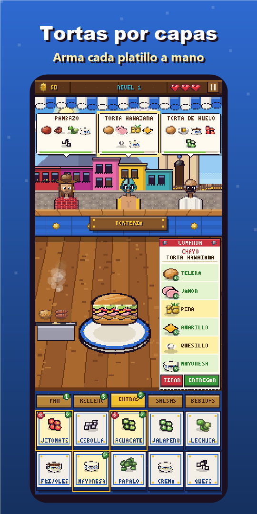
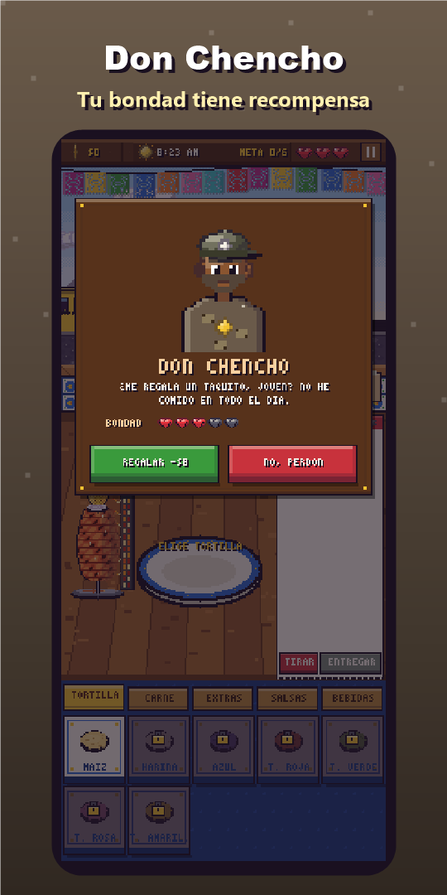
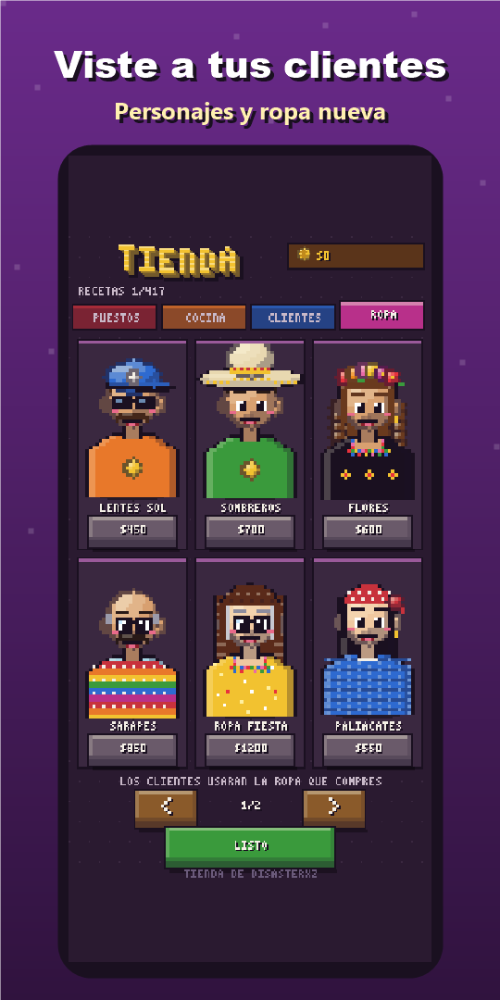
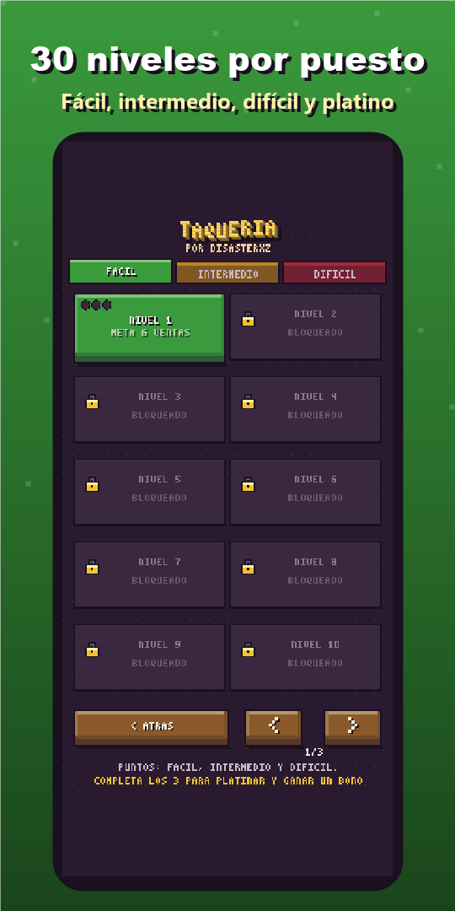
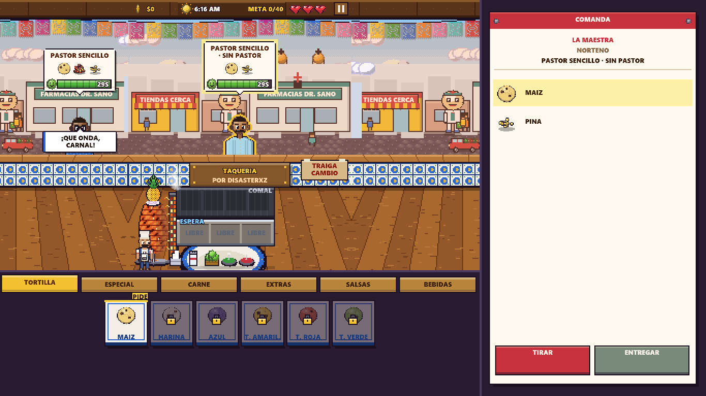
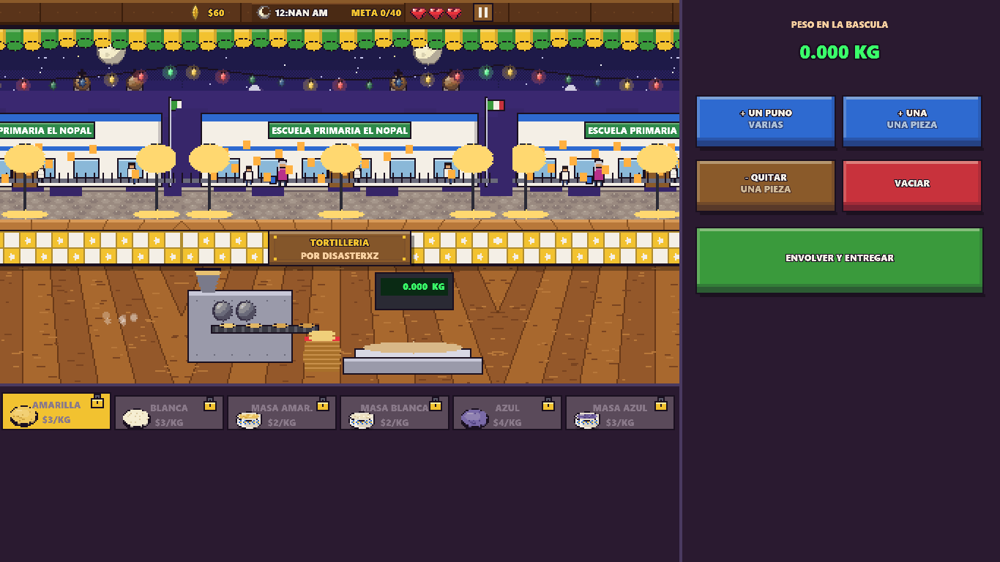
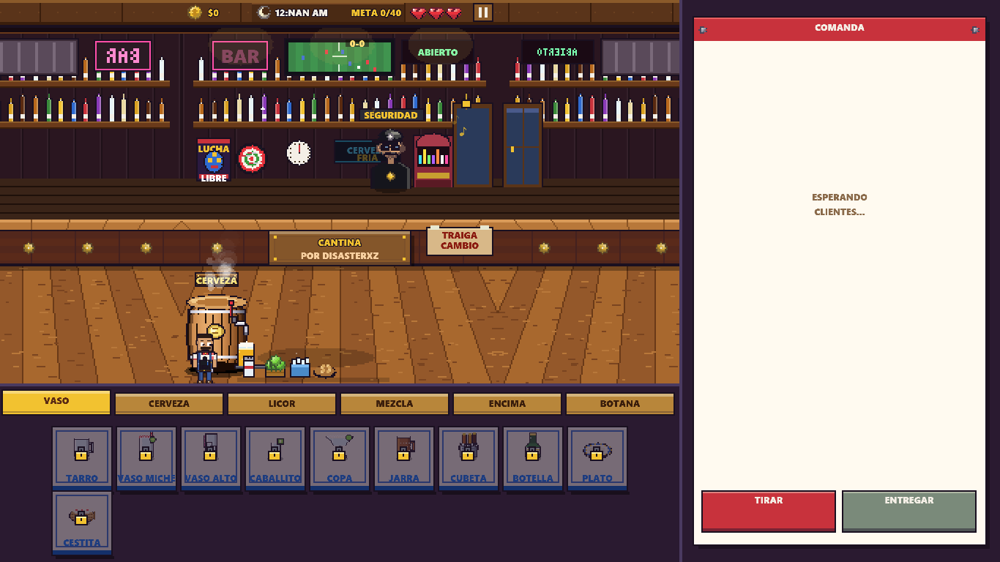
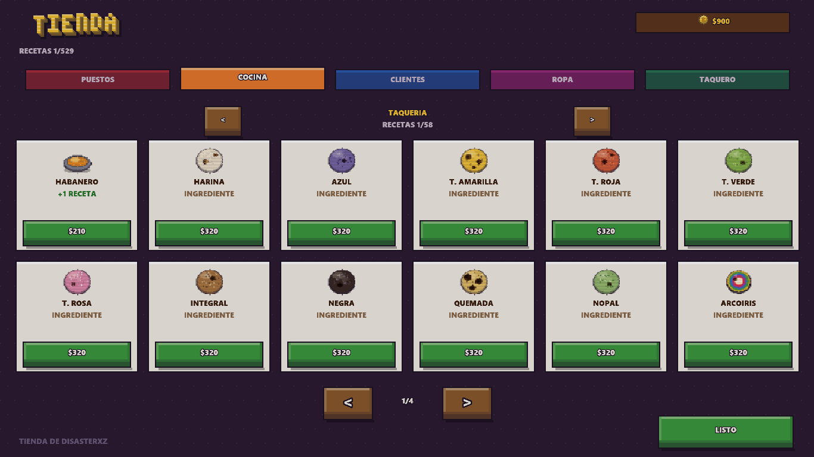
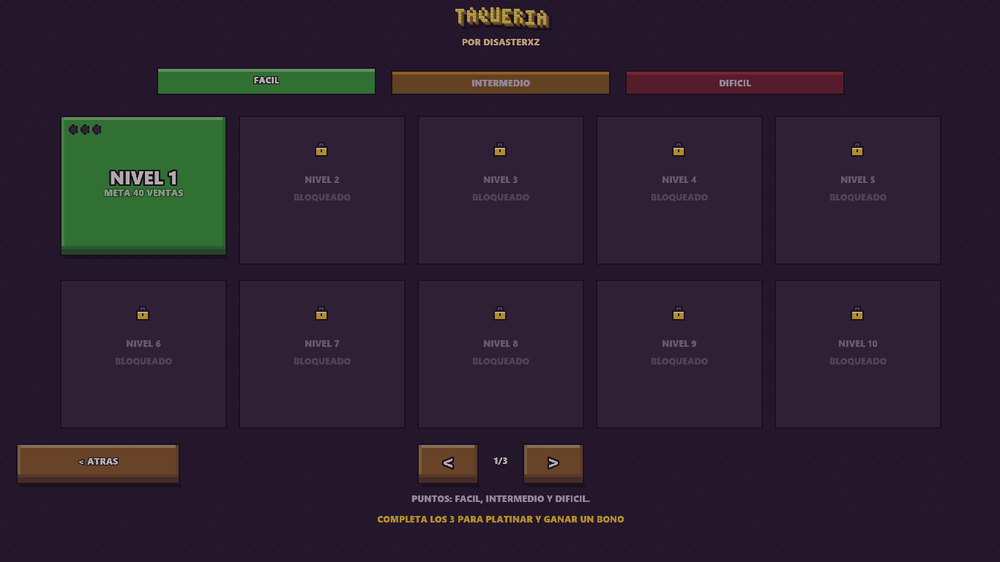

> [!TIP]
> ## 🛡️ Juego 100% seguro — sin virus ni malware
> **¡Órale Tacos! v5.9** se analizó en **VirusTotal** con sus dos archivos, Android y Windows, y **ningún antivirus detectó nada**: **0 detecciones** en el APK (66 motores) y **0 detecciones** en el ejecutable de Windows (61 motores).
>
> [](https://www.virustotal.com/gui/file/a86bae6b56efb62c32800372c2b114d925435e897ff29a08168b021393750832) [](https://www.virustotal.com/gui/file/e6a6a16e9264a380451c9381dd5548e952e9071b60619b1bb985a76c263258ae)
>
> 👉 [Reporte del APK](https://www.virustotal.com/gui/file/a86bae6b56efb62c32800372c2b114d925435e897ff29a08168b021393750832) · [Reporte del .exe de Windows](https://www.virustotal.com/gui/file/e6a6a16e9264a380451c9381dd5548e952e9071b60619b1bb985a76c263258ae) · [Comprobar la huella del archivo](#️-seguridad-libre-de-virus)

<p align="center">
  
</p>

<p align="center">
  <a href="../../releases/latest"></a>
  <a href="../../releases/latest"></a>
</p>

<p align="center"><sub>Un solo <code>.exe</code> portable para Windows 7, 8, 10 y 11, de 32 o 64 bits. No hay que instalar nada.</sub></p>

<p align="center">
  
  
  
  
  
  
  
  <a href="https://www.virustotal.com/gui/file/a86bae6b56efb62c32800372c2b114d925435e897ff29a08168b021393750832"></a>
  <a href="https://www.virustotal.com/gui/file/e6a6a16e9264a380451c9381dd5548e952e9071b60619b1bb985a76c263258ae"></a>
  <a href="https://www.tiktok.com/@disasterxzc"></a>
</p>

<p align="center"><b>Abre tu puesto a las 8 de la mañana, atiende a la clientela más chida de México y cierra a las 11 de la noche con la caja llena.</b></p>

---

## 🌮 ¿Qué es ¡Órale Tacos!?

**¡Órale Tacos!** es un juego de cocina rápida hecho **pixel por pixel**, inspirado en los puestos callejeros de México. Empiezas con una taquería humilde que solo sabe hacer **tacos de pastor sencillos**, y con lo que vendes vas comprando ingredientes, abriendo puestos nuevos y llenando tu barrio de clientes con personalidad: charros, catrinas, luchadores, abuelitas, mariachis, chefs y muchos más.

Cada cliente llega con su pedido, te habla, se desespera si tardas y te deja propina si lo atiendes bien. ¿Te equivocas? Le devuelves su dinero y pagas multa. ¿Tiras un taco? Pierdes los ingredientes. Como en la vida real, mi buen.

---

## 📸 Capturas

<table>
  <tr>
    <td></td>
    <td></td>
    <td></td>
  </tr>
  <tr>
    <td></td>
    <td></td>
    <td></td>
  </tr>
  <tr>
    <td></td>
    <td></td>
    <td></td>
  </tr>
  <tr>
    <td></td>
    <td></td>
    <td></td>
  </tr>
</table>

### 🖥️ Versión de computadora (Windows)

En la computadora la pantalla de juego ocupa todo el ancho: la escena, los clientes repartidos, la comanda a la derecha y la cuadrícula de ingredientes abajo.

<table>
  <tr>
    <td></td>
    <td></td>
  </tr>
  <tr>
    <td></td>
    <td></td>
  </tr>
  <tr>
    <td colspan="2"></td>
  </tr>
</table>

---

## ✨ Lo que vas a encontrar

| | |
|---|---|
| 🏪 **26 puestos** | Taquería, tamalería, tortería, mariscos, nevería, raspados, dulcería, dulces de feria y muchos más. |
| 📖 **529 recetas** | Desde un taco de pastor en tortilla de colores hasta una torta cubana, pan de muerto o ponche navideño. |
| 🧾 **Comanda guiada** | Cada pedido viene con su lista de ingredientes. las flechas te dicen qué falta y la pestaña cambia sola al siguiente paso. |
| 🗣️ **Clientes que hablan** | Más de 150 frases bien mexicanas: amables, apurados, exigentes, bromistas, norteños, chilangos, tiernos, fresas y tímidos. |
| 🕗 **Un día completo** | el cielo pasa de la mañana al atardecer y a la noche. A las 11 PM se baja la cortina. |
| 💰 **Economía real** | Precios de la calle (taco desde $2). Ganas por ventas y propinas, pierdes si tiras o te equivocas, y cada noche pagas la renta del local. |
| 🛒 **Tienda** | Compra puestos, ingredientes, nuevos clientes y ropa para tu clientela. |
| 🎯 **750 niveles** | 30 niveles por puesto en fácil, intermedio y difícil. ¡Complétalos en las tres dificultades para **platinarlos** y ganar un bono! |
| 📅 **Calendario mexicano** | el juego cambia según la fecha: Reyes, Amor y Amistad, Primavera, Día del Niño, Día de las Madres, Día del Maestro, Fiestas Patrias, Halloween, Día de Muertos, Revolución y Navidad, con decoración, música, personajes y platillos de temporada. |
| 🚨 **Eventos sorpresa** | Asaltos (¡hasta se pueden robar el trompo!), billetes falsos que revisas con el plumón detector y patrullas que llegan a ayudarte. |
| 🧔 **Don Chencho** | Un señor sin hogar que te pide un taquito. Si le ayudas, un día te lo paga. Tu **bondad** queda marcada. |
| 💵 **Billetes y monedas** | Tus clientes pagan con billetes y monedas mexicanas y ves el cambio. ¡Favor de traer cambio! |
| 🦗 **Visitas especiales** | Personajes misteriosos que aparecen sobre todo antes de cerrar... ¿los reconoces? |
| 🎨 **Pixel art animado** | Trompo de pastor girando con su piña y su fuego, vaporeras, ollas de barro, garrafas y más. |
| 💡 **Consejos** | Tips cortos que aparecen sin interrumpir la partida. |
| 📱 **Pantalla completa** | Se adapta a cualquier teléfono o tablet, siempre en vertical. |

---

## 🗺️ Los 26 puestos

Cada puesto tiene su propio escenario, utilería animada, barra, clientela y recetas. Toca un puesto para ver todo lo que vende.

| Categoría | Puestos |
|---|---|
| 🍽️ Comida | 🌮 Taquería · 🌽 Tamalería · 🍲 Pozolería · 🥟 Antojitos · 🥖 Tortería · 🥩 Carnitas · 🍜 Birriería · 🍗 al Carbón · 🌭 Jochos y Burgers · 🦐 Mariscos · ⚖️ Tortillería |
| 🍿 Botanas | 🌽 Elotero · 🥨 Botanero · 🍉 Frutería |
| 🍰 Postres | 🍠 Camotero · 🍩 Churrería · 🧺 Pan de Canasta · 🧇 Marquesitas · 🍦 Nevería · 🍧 Raspados · 🍭 Dulces de Feria · 🍬 Dulcería · 🥐 Panadería |
| 🥤 Bebidas | 🍹 Aguas Frescas · 🥕 Jugos y Licuados · 🍺 Cantina |

### 🍽️ Comida (11 puestos)

<details>
<summary><b>🌮 Taquería</b> — 58 recetas · de $1 a $4 · puesto inicial</summary>

El puesto con el que empiezas. Trompo de pastor girando con su piña y su fuego, tortillas de maíz, harina, azul y de colores, carnes, verduras, salsas y aguas.

**Ingredientes:**

- **Tortilla:** Maíz, Harina, Azul, T. Amarilla, T. Roja, T. Verde
- **Especial:** T. Rosa, Integral, Negra, Quemada, Nopal, Arcoíris
- **Carne:** Pastor, Asada, Suadero, Carnitas, Pollo, Chorizo, Barbacoa, Pescado, Camarón, Nopal
- **Extras:** Cebolla, Cilantro, Piña, Limón, Rábano, Pepino, Queso, Guacamole, Frijoles, Col
- **Salsas:** Verde, Roja, Habanero, Pico, Chipotle, Crema
- **Bebidas:** Horchata, Jamaica, Tamarindo, Limonada, Refresco, Naranjada, Mineral

**Recetas:**

| Platillo | Precio |
|---|---|
| Pastor Sencillo | $1 |
| Asada Sencilla | $2 |
| Suadero | $2 |
| Carnitas con Pico | $1 |
| Chorizo con Queso | $1 |
| Gringa | $2 |
| Nopal Vegetariano | $2 |
| Pescado Sencillo | $2 |
| Barbacoa Enchilada | $1 |
| Pollo Chipotle | $2 |
| Pastor Clásico | $3 |
| Asada Callejera | $2 |
| Campechano | $3 |
| Suadero con Todo | $3 |
| Carnitas Michoacanas | $2 |
| Carnitas con Guacamole | $2 |
| Pollo Asado | $2 |
| Pollo Sencillo | $2 |
| Chorizo Callejero | $2 |
| Barbacoa Hidalguense | $3 |
| Taco Baja | $2 |
| Camarón Chipotle | $2 |
| Gobernador | $2 |
| Nopal con Frijol | $3 |
| Azul de Asada | $3 |
| Azul de Barbacoa | $3 |
| Azul de Carnitas | $3 |
| Pastor Norteño | $2 |
| Pastor Picosito | $2 |
| Asada con Frijoles | $2 |
| Asada Norteña | $2 |
| Suadero Azul | $3 |
| Mar y Tierra | $2 |
| Pollo con Frijoles | $2 |
| Campechano Azul | $3 |
| Pescado Azul | $3 |
| Carnitas con Verdura | $2 |
| con Todo Joven | $4 |
| Pastor con Horchata | $3 |
| Asada y Refresco | $3 |
| Suadero con Jamaica | $2 |
| Baja con Limonada | $2 |
| Carnitas y Tamarindo | $2 |
| Gringa con Naranjada | $2 |
| Camarón con Mineral | $2 |
| Pastor en Tortilla Roja | $2 |
| Nopal en Tortilla Verde | $2 |
| Pollo en Tortilla Rosa | $2 |
| Asada en Tortilla Amarilla | $2 |
| Suadero Rojo | $2 |
| Camarón en Tortilla Verde | $2 |
| Taco Arcoíris | $2 |
| Pastor en Tortilla Integral | $2 |
| Suadero en Tortilla Integral | $2 |
| Nopal en Tortilla de Nopal | $2 |
| Asada en Tortilla Negra | $2 |
| Pollo en Tortilla Quemada | $2 |
| Carnitas en Tortilla Arcoíris | $2 |

</details>

<details>
<summary><b>🌽 Tamalería</b> — 23 recetas · de $1 a $3 · se desbloquea con $900</summary>

Vaporera humeante con tamales verdes, rojos, de rajas, mole, oaxaqueños, dulces, de frijol y de elote. Guajolotas y atoles calientitos.

**Ingredientes:**

- **Base:** Plato, Bolillo
- **Tamales:** Verde, Rojo, Rajas, Mole, Dulce, Oaxaqueño, Frijol, Elote
- **Atoles:** Champurrado, Arroz, Fresa, Vainilla, Café Olla, Nuez, Guayaba, Chocolate
- **Extras:** Crema, Queso, Verde, Roja

**Recetas:**

| Platillo | Precio |
|---|---|
| Tamal Verde | $2 |
| Tamal Rojo | $2 |
| Tamal de Mole | $2 |
| Oaxaqueño | $2 |
| Guajolota Verde | $1 |
| Guajolota Roja | $1 |
| Rajas con Crema | $2 |
| Desayuno Dulce | $2 |
| Elote con Crema | $2 |
| Frijol con Queso | $2 |
| Verde y Rojo | $2 |
| Guajolota con Champurrado | $1 |
| Mole con Café de Olla | $2 |
| Elote y Vainilla | $2 |
| Guajolota de Rajas | $1 |
| Oaxaqueño Bañado | $2 |
| Pareja Picosa | $2 |
| Dulce con Champurrado | $2 |
| Trio Mixto | $3 |
| Mole con Chocolate | $2 |
| Guajolota con Atole de Nuez | $1 |
| Dulce con Atole de Guayaba | $2 |
| Rajas con Chocolate | $2 |

</details>

<details>
<summary><b>🍲 Pozolería</b> — 23 recetas · de $6 a $8 · se desbloquea con $1,400</summary>

Olla de barro con pozole rojo, blanco y verde, menudo, pancita, birria, caldo de res, de gallina, tlalpeño y sopa de lima.

**Ingredientes:**

- **Caldo:** Rojo, Blanco, Verde, Menudo, Birria, Res, Tlalpeño, Lima, Gallina
- **Encima:** Lechuga, Rábano, Cebolla, Orégano, Piquín, Limón, Aguacate, Cilantro
- **Al Lado:** Tostada, Crema, Chicharrón, Maíz, Bolillo
- **Bebidas:** Jamaica, Horchata, Limonada, Refresco, Mineral

**Recetas:**

| Platillo | Precio |
|---|---|
| Pozole Rojo Sencillo | $6 |
| Birria Sencilla | $6 |
| Caldo de Res | $6 |
| Menudo Sencillo | $6 |
| Verde con Aguacate | $6 |
| Tlalpeño | $6 |
| Sopa de Lima | $6 |
| Pozole Blanco | $7 |
| Pozole Rojo | $8 |
| Pozole Verde | $7 |
| Menudo Completo | $7 |
| Birria de Jalisco | $7 |
| Caldo de Res Completo | $7 |
| Blanco con Crema | $6 |
| Tlalpeño con Tostada | $6 |
| Rojo con Chicharrón | $6 |
| Pozole con Jamaica | $7 |
| Menudo con Refresco | $6 |
| Birria y Horchata | $6 |
| Caldo de Gallina | $7 |
| Gallina Completo | $7 |
| Pancita | $7 |
| Pancita Sencilla | $6 |

</details>

<details>
<summary><b>🥟 Antojitos</b> — 29 recetas · de $2 a $4 · se desbloquea con $1,800</summary>

Comal con quesadillas al comal y fritas, gorditas, sopes, huaraches, tlacoyos, molotes, empanadas, flautas y tacos dorados.

**Ingredientes:**

- **Base:** Comal, Frita, Gordita, Sope, Huarache, Tlacoyo, Molote, Empanada, Flauta, Dorado
- **Relleno:** Papa, Tinga, Flor Calab., Champiñón, Prensado, Sesos, Picadillo, Requesón, Frijoles, Haba
- **Carnes:** Pollo, Res, Barbacoa, Chorizo, Quesillo
- **Encima:** Crema, Queso, Lechuga, Cebolla, Cilantro, Nopal, Guacamole, Verde, Roja, Pico

**Recetas:**

| Platillo | Precio |
|---|---|
| Quesadilla de Papa | $2 |
| Quesadilla de Tinga | $2 |
| Quesadilla de Flor | $2 |
| Quesadilla de Champiñones | $2 |
| Quesadilla de Chicharrón | $2 |
| Quesadilla Sola | $2 |
| Quesadilla de Sesos | $3 |
| Frita de Papa | $3 |
| Frita de Picadillo | $3 |
| Gordita de Chicharrón | $3 |
| Gordita de Requesón | $2 |
| Sope Sencillo | $3 |
| Sope de Pollo | $4 |
| Sope de Chorizo | $3 |
| Huarache de Chorizo | $3 |
| Huarache de Nopales | $3 |
| Tlacoyo de Frijol | $3 |
| Tlacoyo de Haba | $3 |
| Tlacoyo de Requesón | $3 |
| Molotes de Papa | $3 |
| Molotes de Tinga | $3 |
| Empanada de Picadillo | $2 |
| Empanada de Tinga | $2 |
| Flautas de Pollo | $3 |
| Flautas de Res | $3 |
| Flautas de Papa | $3 |
| Dorados de Barbacoa | $3 |
| Dorados de Pollo | $3 |
| Dorados de Papa | $3 |

</details>

<details>
<summary><b>🥖 Tortería</b> — 16 recetas · de $4 a $6 · se desbloquea con $2,700</summary>

Tortas armadas capa por capa: milanesa, pierna, jamón, cubana, suiza, hawaiana, ahogadas, cemitas poblanas y pambazos.

**Ingredientes:**

- **Pan:** Telera, Cemita, Pambazo, Birote
- **Relleno:** Milanesa, Pierna, Jamón, Salchicha, Amarillo, Quesillo, Huevo, Papa Chorizo, Carnitas, Piña
- **Extras:** Jitomate, Cebolla, Aguacate, Jalapeño, Lechuga, Frijoles, Mayonesa, Pápalo, Crema, Queso
- **Salsas:** Ahogada, de Arbol, Chipotle
- **Bebidas:** Refresco, Naranjada, Horchata, Jamaica

**Recetas:**

| Platillo | Precio |
|---|---|
| Torta de Jamón | $5 |
| Torta de Salchicha | $5 |
| Torta de Huevo | $5 |
| Torta de Pierna | $5 |
| Torta de Milanesa | $6 |
| Torta Cubana | $6 |
| Torta Suiza | $5 |
| Torta Hawaiana | $5 |
| Torta Ahogada | $5 |
| Ahogada Media | $4 |
| Cemita Poblana | $5 |
| Cemita de Pierna | $5 |
| Pambazo | $5 |
| Pambazo con Chipotle | $5 |
| Milanesa y Refresco | $5 |
| Suiza con Jamaica | $5 |

</details>

<details>
<summary><b>🥩 Carnitas</b> — 15 recetas · de $1 a $3 · se desbloquea con $3,000</summary>

Cazo de cobre con maciza, cuerito, buche, nana y surtida, por taco, torta o por kilo.

**Ingredientes:**

- **Base:** Maíz, Bolillo, Por Kilo
- **Carne:** Maciza, Cuerito, Buche, Nana, Surtida, Chicharrón
- **Extras:** Cebolla, Cilantro, Limón, Guacamole, Pico, Verde, Roja, Nopal
- **Bebidas:** Refresco, Jamaica, Horchata, Mineral

**Recetas:**

| Platillo | Precio |
|---|---|
| Taco de Maciza | $2 |
| Taco de Cuerito | $2 |
| Taco de Buche | $2 |
| Taco de Nana | $2 |
| Taco Surtido | $2 |
| Surtido con Todo | $3 |
| Maciza con Guacamole | $1 |
| Chicharrón en Salsa | $1 |
| Torta de Carnitas | $1 |
| Torta de Cuerito | $1 |
| Medio Kilo de Maciza | $2 |
| Kilo Surtido | $3 |
| Maciza y Refresco | $2 |
| Buche y Jamaica | $2 |
| Surtido con Horchata | $2 |

</details>

<details>
<summary><b>🍜 Birriería</b> — 13 recetas · de $2 a $4 · se desbloquea con $3,600</summary>

Birria, quesabirrias, barbacoa y consomé bien calientito.

**Ingredientes:**

- **Base:** Maíz, Quesabirria, Consome, Plato
- **Carne:** Birria, Barbacoa, Quesillo
- **Extras:** Cebolla, Cilantro, Limón, Rábano, Roja, Verde, Guacamole
- **Consome:** Consome, Refresco, Jamaica, Horchata

**Recetas:**

| Platillo | Precio |
|---|---|
| Taco de Birria | $3 |
| Quesabirria | $3 |
| Quesabirria con Consome | $3 |
| Quesabirria Picosa | $2 |
| Taco de Barbacoa | $3 |
| Barbacoa con Consome | $3 |
| Consome de Birria | $3 |
| Consome de Barbacoa | $3 |
| Plato de Birria | $4 |
| Plato de Barbacoa | $4 |
| Birria con Guacamole | $2 |
| Barbacoa y Refresco | $3 |
| Quesabirria y Jamaica | $3 |

</details>

<details>
<summary><b>🍗 al Carbón</b> — 16 recetas · de $8 a $9 · se desbloquea con $4,600</summary>

Asador con pollos rostizados y al carbón, alitas, boneless, costillas y parrilladas con sus salsas.

**Ingredientes:**

- **Base:** Rostizado, al Carbón, Alitas, Boneless, Costillas, Parrillada
- **Salsas:** Bufalo, Bbq, Mango Hab., Tamarindo, Lemon Pep.
- **Lado:** Papas, Cebollitas, Maíz, Arroz, Frijoles, Apio Zanah., Aderezo, Roja
- **Bebidas:** Refresco, Naranjada, Mineral, Limonada

**Recetas:**

| Platillo | Precio |
|---|---|
| Pollo Rostizado | $8 |
| Pollo al Carbón | $8 |
| Pollo con Arroz | $8 |
| Pollo y Papas | $8 |
| Alitas Bufalo | $8 |
| Alitas Bbq | $8 |
| Alitas Mango Habanero | $8 |
| Alitas Lemon Pepper | $8 |
| Boneless Bbq | $8 |
| Boneless Bufalo | $8 |
| Boneless de Tamarindo | $8 |
| Costillas Bbq | $8 |
| Costillas al Tamarindo | $8 |
| Parrillada Callejera | $9 |
| Parrillada Completa | $9 |
| Alitas y Refresco | $8 |

</details>

<details>
<summary><b>🌭 Jochos y Burgers</b> — 15 recetas · de $3 a $5 · se desbloquea con $5,000</summary>

Jochos con tocino, hamburguesas al carbón, banderillas y salchipulpos con papas.

**Ingredientes:**

- **Base:** Pan Jocho, Pan Burger, Banderilla, Band. Queso, Salchipulpo
- **Relleno:** Salchicha, Carne, Tocino, Amarillo, Ceb. Asada, Jitomate, Jalapeño, Lechuga, Aguacate, Piña
- **Aderezos:** Catsup, Mostaza, Mayonesa, Salsa, Chipotle
- **Lado:** Papas, Refresco, Naranjada, Mineral

**Recetas:**

| Platillo | Precio |
|---|---|
| Jocho Sencillo | $3 |
| Jocho con Tocino | $5 |
| Jocho Norteño | $5 |
| Jocho Hawaiano | $4 |
| Hamburguesa Sencilla | $4 |
| Hamburguesa con Queso | $4 |
| Hamburguesa con Tocino | $4 |
| Hamburguesa Hawaiana | $4 |
| Hamburguesa al Chipotle | $4 |
| Banderilla de Salchicha | $3 |
| Banderilla de Queso | $3 |
| Salchipulpos con Papas | $3 |
| Salchipulpos Picosos | $3 |
| Combo Jocho | $5 |
| Combo Hamburguesa | $5 |

</details>

<details>
<summary><b>🦐 Mariscos</b> — 15 recetas · de $6 a $7 · se desbloquea con $6,500</summary>

Cocteles de camarón y pulpo, tostadas de ceviche, aguachiles y pescadillas frente al mar.

**Ingredientes:**

- **Base:** Copa, Tostada, Molcajete, Pescadilla
- **Marisco:** Camarón, Ceviche, Pulpo, Pescado
- **Extras:** Ceb. Morada, Pepino, Aguacate, Jitomate, Cilantro, Limón, Mayonesa
- **Salsas:** Coctel, Negra, Verde, Salsa
- **Lado:** Galletas, Tostadas, Mineral, Refresco

**Recetas:**

| Platillo | Precio |
|---|---|
| Coctel de Camarón | $7 |
| Coctel Campechano | $7 |
| Coctel de Pulpo | $6 |
| Coctel Picoso | $6 |
| Coctel con Galletas | $6 |
| Tostada de Ceviche | $7 |
| Tostada de Camarón | $6 |
| Tostada de Pulpo | $6 |
| Tostada Mixta | $6 |
| Ceviche con Tostadas | $6 |
| Aguachile Verde | $6 |
| Aguachile Negro | $6 |
| Aguachile Rojo | $6 |
| Pescadillas | $6 |
| Pescadillas con Aguacate | $6 |

</details>

<details>
<summary><b>⚖️ Tortillería</b> — 6 recetas · de $2 a $4 · se desbloquea con $1,200</summary>

Venta por kilo con báscula: la tortilladora trabaja sin parar y tú pesas un cuarto, medio kilo o un kilo. Tortilla amarilla y blanca toda la semana, masa amarilla y blanca, y tortilla y masa azul solo sábado y domingo. Si das de más pierdes; si das de menos compensas.

**Ingredientes:**

- **Producto:** Amarilla, Blanca, Masa Amar., Masa Blanca, Azul, Masa Azul

**Recetas:**

| Platillo | Precio |
|---|---|
| Tortilla Amarilla Por Kilo | $3 |
| Tortilla Blanca Por Kilo | $3 |
| Masa Amarilla Por Kilo | $2 |
| Masa Blanca Por Kilo | $2 |
| Tortilla Azul - Fin de Semana | $4 |
| Masa Azul - Fin de Semana | $3 |

</details>

### 🍿 Botanas (3 puestos)

<details>
<summary><b>🌽 Elotero</b> — 21 recetas · de $3 a $5 · se desbloquea con $1,100</summary>

Carrito elotero: elotes, elotes asados, esquites, trolelotes, chaskas y sopa con esquite.

**Ingredientes:**

- **Base:** Elote, Asado, Esquite, Sopa
- **Encima:** Mayonesa, Crema, Queso, Chile, Limón, Salsa, Sal, Mantequilla, Epazote
- **Extras:** Frituras, Granos, Chamoy, Chilito
- **Bebidas:** Refresco, Naranjada, Tamarindo, Jamaica, Mineral

**Recetas:**

| Platillo | Precio |
|---|---|
| Elote con Limón y Sal | $3 |
| Elote Sencillo | $3 |
| Esquite Sencillo | $3 |
| Asado con Crema | $3 |
| Elote Clásico | $4 |
| Esquite Clásico | $4 |
| Elote Asado | $3 |
| Esquite Picoso | $4 |
| Esquite Cremoso | $3 |
| Esquite de Epazote | $3 |
| Asado con Todo | $4 |
| Elote Preparado | $5 |
| Elote y Refresco | $4 |
| Esquite con Tamarindo | $4 |
| Asado con Naranjada | $3 |
| Trolelote | $4 |
| Trolelote con Limón | $4 |
| Chaska | $5 |
| Chaska con Chilito | $4 |
| Sopa con Esquite | $4 |
| Sopa Preparada | $4 |

</details>

<details>
<summary><b>🥨 Botanero</b> — 15 recetas · de $3 a $6 · se desbloquea con $3,600</summary>

Fritulocos, totolocos, chicharrón de harina preparado, papas con limón y cacahuates japoneses, salados y enchilados.

**Ingredientes:**

- **Base:** Fritura, Totopos, Chicharrón, Papas, Bolsita
- **Picado:** Cueritos, Col, Jícama, Pepino, Aguacate, Queso, Crema, Cebolla
- **Dulces:** Japones, Salados, Enchilados, Gomitas, Gom. Ench., Pepitas
- **Salsas:** Chamoy, Salsa, Limón, Chilito, Sal, Inglesa
- **Bebidas:** Refresco, Mineral, Tamarindo, Jamaica

**Recetas:**

| Platillo | Precio |
|---|---|
| Fritulocos | $5 |
| Fritulocos Dulces | $5 |
| Totolocos | $5 |
| Totolocos con Queso | $4 |
| Chicharrón Preparado | $4 |
| Chicharrón con Todo | $6 |
| Chicharrón Sencillo | $3 |
| Papas con Limón y Salsa | $3 |
| Papas Enchiladas | $3 |
| Papas Preparadas | $4 |
| Cacahuates Japoneses | $3 |
| Cacahuates Salados | $3 |
| Cacahuates Enchilados | $4 |
| Gomitas Enchiladas | $3 |
| Bolsita Mixta | $4 |

</details>

<details>
<summary><b>🍉 Frutería</b> — 15 recetas · de $3 a $5 · se desbloquea con $2,200</summary>

Vasos de fruta con limón, sal y chile, vasos locos con gomitas y chamoy, y cocteles con yogurt, granola y miel.

**Ingredientes:**

- **Vaso:** Vaso, Vaso Loco, Coctel
- **Fruta:** Jícama, Pepino, Mango, Sandía, Piña, Melón, Coco, Fresa, Plátano, Papaya
- **Encima:** Limón, Sal, Piquín, Chamoy, Chilito, Gomitas, Japones, Yogurt, Granola, Miel

**Recetas:**

| Platillo | Precio |
|---|---|
| Vaso de Mango | $3 |
| Vaso de Jícama | $4 |
| Pepino con Chile | $4 |
| Sandía con Limón | $3 |
| Fruta Mixta | $5 |
| Vaso de Coco | $3 |
| Mango con Chamoy | $4 |
| Melón y Papaya | $3 |
| Vaso Loco | $5 |
| Vaso Loco de Mango | $4 |
| Vaso Loco de Sandía | $4 |
| Coctel de Frutas | $5 |
| Coctel con Yogurt | $4 |
| Coctel Tropical | $5 |
| Fresas con Yogurt | $3 |

</details>

### 🍰 Postres (9 puestos)

<details>
<summary><b>🍠 Camotero</b> — 13 recetas · de $3 a $3 · se desbloquea con $2,400</summary>

Carrito camotero con su silbato: camotes y plátanos horneados y plátanos fritos con crema y queso.

**Ingredientes:**

- **Base:** Camote, Plátano, Fritos
- **Encima:** Leche Cond., Mermelada, Crema, Queso, Canela, Azúcar, Cajeta, Miel, Nuez
- **Bebidas:** Café Olla, Champurrado, Chocolate

**Recetas:**

| Platillo | Precio |
|---|---|
| Camote con Leche | $3 |
| Camote con Mermelada | $3 |
| Camote con Todo | $3 |
| Camote con Cajeta | $3 |
| Camote con Miel | $3 |
| Plátano Horneado | $3 |
| Plátano con Mermelada | $3 |
| Plátano con Canela | $3 |
| Plátanos Fritos | $3 |
| Plátanos Fritos Dulces | $3 |
| Plátanos con Todo | $3 |
| Camote y Café de Olla | $3 |
| Plátano y Champurrado | $3 |

</details>

<details>
<summary><b>🍩 Churrería</b> — 19 recetas · de $2 a $2 · se desbloquea con $3,300</summary>

Churros azucarados y rellenos, donas, buñuelos, gorditas de nata, waffles en palo y hot cakes.

**Ingredientes:**

- **Base:** Churro, Relleno, Dona, Buñuelo, G. de Nata, Waffle, Hot Cakes
- **Encima:** Azúcar, Canela, Cajeta, Chocolate, Leche Cond., Mermelada, Avellana, Chispas, Nuez, Miel
- **Bebidas:** Chocolate, Café Olla, Champurrado, Arroz

**Recetas:**

| Platillo | Precio |
|---|---|
| Churros Azucarados | $2 |
| Churro de Cajeta | $2 |
| Churro de Chocolate | $2 |
| Churro de Leche Condensada | $2 |
| Churro de Fresa | $2 |
| Churros con Chocolate | $2 |
| Dona con Chispas | $2 |
| Dona de Chocolate | $2 |
| Dona Espolvoreada | $2 |
| Donas y Café | $2 |
| Buñuelo con Miel | $2 |
| Buñuelo Azucarado | $2 |
| Gorditas de Nata | $2 |
| Nata con Cajeta | $2 |
| Waffle con Chocolate | $2 |
| Waffle de Avellana | $2 |
| Hot Cakes Mini | $2 |
| Hot Cakes con Cajeta | $2 |
| Hot Cakes de Chocolate | $2 |

</details>

<details>
<summary><b>🧺 Pan de Canasta</b> — 20 recetas · de $1 a $2 · se desbloquea con $4,200</summary>

Canasta de pan dulce: conchas, cuernitos, orejas, mantecadas, ojos de buey, garibaldis, pan de feria, pan de muerto y rosca de reyes.

**Ingredientes:**

- **Base:** Charola, Bolsa
- **Pan:** Concha, Concha Ch., Cuernito, Oreja, Mantecada, Ojo Buey, Garibaldi, Feria Nuez, Feria Crema, Dona
- **Temporada:** Pan Muerto, Rosca
- **Bebidas:** Café Olla, Chocolate, Champurrado, Arroz, Vainilla

**Recetas:**

| Platillo | Precio |
|---|---|
| Concha de Vainilla | $1 |
| Concha de Chocolate | $1 |
| Concha con Café | $1 |
| Cuernito con Chocolate | $1 |
| Orejas | $1 |
| Ojo de Buey | $1 |
| Mantecada con Atole | $1 |
| Pan de Feria de Nuez | $1 |
| Pan de Feria de Crema | $1 |
| Pan de Feria con Café | $1 |
| Dona y Champurrado | $1 |
| Merienda Completa | $1 |
| Dos Conchas | $1 |
| Bolsa Surtida | $2 |
| Garibaldis | $1 |
| Desayuno de Canasta | $2 |
| Pan de Muerto | $1 |
| Pan de Muerto con Chocolate | $1 |
| Rosca de Reyes | $1 |
| Rosca con Chocolate | $1 |

</details>

<details>
<summary><b>🧇 Marquesitas</b> — 16 recetas · de $4 a $5 · se desbloquea con $4,600</summary>

Marquesitas con queso de bola y crepas dulces y saladas hechas en la plancha.

**Ingredientes:**

- **Base:** Marquesita, Crepa Dulce, Crepa Sal.
- **Dulce:** Queso Bola, Avellana, Cajeta, Mermelada, Leche Cond., Chocolate, Plátano, Fresa, Nuez, Chispas
- **Salado:** Jamón, Quesillo, Champiñón, Pollo, Espinaca, Granos, Chipotle, Crema
- **Bebidas:** Café Olla, Chocolate, Horchata, Limonada

**Recetas:**

| Platillo | Precio |
|---|---|
| Marquesita de Queso | $4 |
| Marquesita de Avellana | $4 |
| Queso y Avellana | $4 |
| Marquesita de Cajeta | $4 |
| Marquesita de Mermelada | $4 |
| Marquesita de Plátano | $4 |
| Crepa de Fresa | $4 |
| Crepa de Plátano | $4 |
| Crepa de Cajeta y Nuez | $4 |
| Crepa de Chocolate | $4 |
| Crepa de Jamón y Queso | $4 |
| Crepa de Champiñones | $4 |
| Crepa de Pollo | $4 |
| Crepa de Espinaca | $4 |
| Crepa de Elote | $5 |
| Crepa y Café | $4 |

</details>

<details>
<summary><b>🍦 Nevería</b> — 18 recetas · de $3 a $3 · se desbloquea con $5,400</summary>

Nieves de garrafa (limón, mamey, beso de ángel, nuez, queso...), paletas de hielo y esquimales.

**Ingredientes:**

- **Base:** Cono, Vasito, Paleta, Esquimal
- **Sabor:** Nieve Lim., Mamey, Beso Angel, Nuez, Queso, Fresa, Chocolate, Vainilla, Mango, Tamarindo
- **Encima:** Chispas, Nuez, Coco, Chocolate, Cajeta, Chamoy, Chilito, Cereza

**Recetas:**

| Platillo | Precio |
|---|---|
| Nieve de Limón | $3 |
| Nieve de Mamey | $3 |
| Beso de Angel | $3 |
| Nieve de Nuez | $3 |
| Nieve de Queso | $3 |
| Fresa y Vainilla | $3 |
| Napolitano | $3 |
| Mango con Chile | $3 |
| Nieve de Tamarindo | $3 |
| Cono con Chispas | $3 |
| Limón y Mamey | $3 |
| Vasito con Cajeta | $3 |
| Paleta de Limón | $3 |
| Paleta de Fresa | $3 |
| Paleta de Mango Enchilada | $3 |
| Esquimal de Coco | $3 |
| Esquimal de Nuez | $3 |
| Esquimal de Fresa | $3 |

</details>

<details>
<summary><b>🍧 Raspados</b> — 14 recetas · de $3 a $4 · se desbloquea con $5,800</summary>

Raspados de grosella, tamarindo, limón, rompope y más; diablitos y chamoyadas.

**Ingredientes:**

- **Base:** Raspado, Chamoyada
- **Jarabe:** Grosella, Tamarindo, Jarabe. Limón, Rompope, Vainilla, Jarabe. Mango, Fresa, Nanche
- **Encima:** Chamoy, Chilito, Leche Cond., Mango, Gomitas, Tamarindo, Nieve Lim., Limón

**Recetas:**

| Platillo | Precio |
|---|---|
| Raspado de Grosella | $3 |
| Raspado de Tamarindo | $3 |
| Raspado de Limón | $3 |
| Raspado de Rompope | $3 |
| Vainilla con Leche | $3 |
| Fresa con Leche | $3 |
| Raspado de Nanche | $3 |
| Raspado Mixto | $3 |
| Fresa y Mango | $3 |
| Diablito | $4 |
| Diablito con Nieve | $4 |
| Chamoyada de Mango | $4 |
| Chamoyada Loca | $4 |
| Chamoyada de Tamarindo | $4 |

</details>

<details>
<summary><b>🍭 Dulces de Feria</b> — 21 recetas · de $2 a $2 · se desbloquea con $7,500</summary>

Algodones de azúcar, manzanas acarameladas y con chamoy, palomitas, alegrías, palanquetas, pepitorias, arroz con leche, gelatinas, flanes y fresas con crema.

**Ingredientes:**

- **Feria:** Algodón, Alg. Azul, Manzana, Manz. Chamoy, Palomitas, Alegría, Palanqueta, Pepitoria
- **Postre:** Arroz Leche, Gelatina, Flan, Fresas
- **Encima:** Mantequilla, Caramelo, Chilito, Chamoy, Limón, Canela, Crema, Leche Cond., Chispas, Nuez
- **Bebidas:** Refresco, Chocolate, Tamarindo, Horchata

**Recetas:**

| Platillo | Precio |
|---|---|
| Algodón Rosa | $2 |
| Algodón Azul | $2 |
| Manzana Acaramelada | $2 |
| Manzana con Chamoy | $2 |
| Manzana Enchilada | $2 |
| Palomitas de Mantequilla | $2 |
| Palomitas Acarameladas | $2 |
| Palomitas Enchiladas | $2 |
| Palomitas Preparadas | $2 |
| Palomitas y Refresco | $2 |
| Alegría | $2 |
| Palanqueta | $2 |
| Pepitoria | $2 |
| Arroz con Leche | $2 |
| Arroz con Leche y Nuez | $2 |
| Gelatina | $2 |
| Gelatina con Crema | $2 |
| Flan Napolitano | $2 |
| Flan con Caramelo | $2 |
| Fresas con Crema | $2 |
| Fresas con Chispas | $2 |

</details>

<details>
<summary><b>🍬 Dulcería</b> — 17 recetas · de $1 a $2 · se desbloquea con $2,600</summary>

Dulces típicos mexicanos: mazapanes, obleas, cocadas, borrachitos, jamoncillos, glorias, ate, muéganos, tamarindo enchilado y más.

**Ingredientes:**

- **Base:** Bolsita, Charola
- **Dulces:** Mazapán, Oblea, Cocada, Borrachito, Jamoncillo, Gloria, Ate, Muégano, Tamarindo, Paleta
- **Típicos:** Alegría, Palanqueta, Pepitoria, Camote Pob., Cajeta, Calabaza
- **Extras:** Chilito, Chamoy, Limón

**Recetas:**

| Platillo | Precio |
|---|---|
| Bolsita de Mazapanes | $1 |
| Obleas con Cajeta | $1 |
| Cocadas | $1 |
| Borrachitos | $1 |
| Jamoncillos | $1 |
| Glorias | $1 |
| Ate de Membrillo | $1 |
| Muéganos | $1 |
| Tamarindo Enchilado | $1 |
| Paleta Enchilada | $1 |
| Dulces Típicos | $1 |
| Camotes Poblanos | $1 |
| Bolsita Surtida | $2 |
| Bolsita Picosa | $2 |
| Charola de La Abuela | $2 |
| Dulces de Fiesta | $2 |
| Calabaza en Tacha | $1 |

</details>

<details>
<summary><b>🥐 Panadería</b> — 12 recetas · de $1 a $40 · se desbloquea con $2,800</summary>

Panadería de verdad: eliges el pan, le pones sus ingredientes, amasas, lo horneas sin que se queme y surtes la vitrina. Los clientes entran con la campanita, toman charola y pinzas, y tú les cobras con la tabla de precios. Incluye rosca de reyes, pan de muerto y pasteles de cumpleaños por encargo.

**Ingredientes:**

- **Panes:** Concha, Concha Ch., Cuernito, Oreja, Mantecada, Ojo Buey, Garibaldi, Dona, Bolillo, Pan Muerto
- **Especiales:** Rosca, Pastel

**Recetas:**

| Platillo | Precio |
|---|---|
| Concha de Vainilla | $2 |
| Concha de Chocolate | $2 |
| Cuernito | $1 |
| Oreja | $1 |
| Mantecada | $2 |
| Ojo de Buey | $2 |
| Garibaldi | $1 |
| Dona | $2 |
| Bolillo | $1 |
| Pan de Muerto | $4 |
| Rosca de Reyes | $20 |
| Pastel de Cumpleaños | $40 |

</details>

### 🥤 Bebidas (3 puestos)

<details>
<summary><b>🍹 Aguas Frescas</b> — 25 recetas · de $2 a $3 · se desbloquea con $2,000</summary>

Vitroleros con aguas frescas, tepache, tejuino, pozol, rusas, micheladas sin alcohol y ponche navideño.

**Ingredientes:**

- **Vaso:** Vaso, Bolsita, Jarrito
- **Aguas:** Horchata, Jamaica, Tamarindo, Limón Chia, Alfalfa, Pepino, Melón, Sandía, Piña, Fresa
- **Tipicas:** Tepache, Tejuino, Pozol, Rusa, Michelada, Ponche
- **Extras:** Hielo, Limón, Sal, Chamoy, Chilito, Nieve Lim., Canela, Fruta, Inglesa

**Recetas:**

| Platillo | Precio |
|---|---|
| Agua de Horchata | $2 |
| Horchata con Canela | $2 |
| Agua de Jamaica | $2 |
| Agua de Tamarindo | $2 |
| Limón con Chia | $2 |
| Agua de Alfalfa | $2 |
| Agua de Pepino | $2 |
| Agua de Melón | $2 |
| Agua de Sandía | $2 |
| Agua de Piña | $2 |
| Horchata con Jamaica | $2 |
| Agua de Fresa en Bolsita | $2 |
| Jamaica en Bolsita | $2 |
| Horchata en Bolsita | $2 |
| Tepache | $2 |
| Tepache Preparado | $2 |
| Tejuino | $3 |
| Tejuino con Chamoy | $3 |
| Pozol | $2 |
| Pozol Frio | $2 |
| Rusa | $3 |
| Rusa con Chamoy | $3 |
| Michelada sin Alcohol | $3 |
| Ponche Navideño | $2 |
| Ponche con Fruta | $2 |

</details>

<details>
<summary><b>🥕 Jugos y Licuados</b> — 16 recetas · de $3 a $4 · se desbloquea con $3,900</summary>

Jugos recién exprimidos (naranja, zanahoria, betabel, verde) y licuados de plátano, fresa, chocolate, avena y mamey.

**Ingredientes:**

- **Vaso:** Jugo, Licuado
- **Fruta:** Naranja, Zanahoria, Betabel, Nopal, Apio, Piña, Plátano, Fresa, Mamey, Papaya
- **Extras:** Avena, Chocolate, Miel, Granola, Canela, Hielo, Nuez, Vainilla

**Recetas:**

| Platillo | Precio |
|---|---|
| Jugo de Naranja | $3 |
| Jugo de Zanahoria | $3 |
| Zanahoria con Naranja | $3 |
| Jugo de Betabel | $3 |
| Vampiro | $3 |
| Jugo Verde | $4 |
| Jugo Verde con Miel | $4 |
| Jugo de Piña | $3 |
| Licuado de Plátano | $3 |
| Licuado de Fresa | $3 |
| Licuado de Chocolate | $3 |
| Licuado de Avena | $3 |
| Licuado de Mamey | $3 |
| Licuado de Papaya | $3 |
| Licuado Energético | $4 |
| Fresa y Plátano | $3 |

</details>

<details>
<summary><b>🍺 Cantina</b> — 58 recetas · de $3 a $12 · se desbloquea con $6,800</summary>

Bar de noche con micheladas, cervezas, tragos preparados, copas, botellas y botanas. Llegan clientes que piden sin cebolla o con extra, hay fiestas con DJ y, a veces, una pelea de bar que el guardia tiene que separar.

**Ingredientes:**

- **Vaso:** Tarro, Vaso Miche, Vaso Alto, Caballito, Copa, Jarra, Cubeta, Botella, Plato, Cestita
- **Cerveza:** Clara, Oscura, Ambar, Light, de Trigo, Artesanal, Negra, de Barril, sin Alcohol
- **Licor:** Tequila, Mezcal, Ron, Whisky, Vodka, Brandy, Ginebra, Sotol
- **Mezcla:** Jugo Tomate, Sazonador, S. Inglesa, Picante, Refresco, Naranjada, Mineral, Toronja, Grosella, Hielo
- **Encima:** Limón, Sal, Sal Gusano, Chile Polvo, Chamoy, Gomitas, Pepino, Camarón, Rodaja Naranja, Mango
- **Botana:** Cacahuates, Chicharrón, Nachos, Cueritos, Carne Seca, Aceitunas, Queso, Pistaches, Pepitas, Japones

**Recetas:**

| Platillo | Precio |
|---|---|
| Cerveza Clara | $3 |
| Chelada | $4 |
| Michelada Clásica | $5 |
| Cerveza Oscura | $3 |
| Cerveza Ambar | $3 |
| Cerveza Light | $3 |
| Cerveza de Trigo | $3 |
| Cerveza Artesanal | $3 |
| Cerveza Negra | $3 |
| Cerveza de Barril | $3 |
| Cerveza sin Alcohol | $3 |
| Chelada con Chile | $4 |
| Michelada Oscura | $5 |
| Michelada Picosa | $5 |
| Michelada con Camarón | $5 |
| Michelada con Gomitas | $5 |
| Michelada de Mango | $5 |
| Michelada con Pepino | $5 |
| Michelada Ambar | $5 |
| Michelada sin Alcohol | $4 |
| Cubetazo | $4 |
| Cubeta Michelada | $5 |
| Caguama | $12 |
| Tequila Solo | $3 |
| Tequila con Limón y Sal | $3 |
| Mezcal con Naranja | $3 |
| Mezcal con Sal de Gusano | $3 |
| Sotol Solo | $3 |
| Ron Solo | $3 |
| Brandy | $3 |
| Whisky en Las Rocas | $3 |
| Vodka con Naranja | $3 |
| Ginebra con Mineral | $4 |
| Cuba Libre | $4 |
| Cuba de Whisky | $4 |
| Paloma | $4 |
| Tequila Sunrise | $4 |
| Margarita | $4 |
| Margarita de Mango | $4 |
| Mezcalita | $4 |
| Copa de Brandy | $3 |
| Botella de Tequila | $12 |
| Botella de Mezcal | $12 |
| Botella de Ron | $12 |
| Botella de Whisky | $12 |
| Botella de Vodka | $12 |
| Cacahuates | $3 |
| Chicharrón con Limón | $3 |
| Nachos con Queso | $3 |
| Cueritos Picosos | $3 |
| Carne Seca con Limón | $3 |
| Aceitunas | $3 |
| Pistaches | $3 |
| Cacahuates Japoneses | $3 |
| Pepitas con Chile | $3 |
| Tabla de Quesos | $3 |
| Surtido de Botanas | $4 |
| Botana de La Casa | $4 |

</details>

---

## 🎮 Modos de juego

| Modo | ¿Cómo se juega? | Se desbloquea |
|---|---|---|
| 🟢 **Clásico** | Un día completo de 8 AM a 11 PM. Cumple la meta de ventas antes de cerrar. | Desde el inicio |
| 🟠 **Contrarreloj** | 90 segundos para vender todo lo que puedas. | al pasar el nivel 3 |
| 🟣 **Maestro** | Solo ves el nombre del platillo y pagan el doble. ¡Sin ayudas! | al pasar el nivel 6 |

---

## 📅 Calendario de festividades mexicanas

El juego lee la fecha de tu teléfono y se viste de fiesta: decoración, efectos, **música con otro tono**, personajes de temporada, ropa festiva para los clientes, platillos de temporada que te piden más y **+$1 por venta**.

| Festividad | Fechas | Visitas de temporada | Lo que más piden |
|---|---|---|---|
| Día de Reyes | 3 ene – 10 ene | el Rey Mago | Rosca de Reyes, Rosca con Chocolate |
| Amor y Amistad | 1 feb – 20 feb | Cupido | Fresas con Crema, Fresas con Chispas, Crepa de Fresa |
| Primavera | 15 mar – 5 abr | la Reina de la Primavera | Fruta Mixta, Agua de Sandía |
| Día del Niño | 20 abr – 30 abr | Juanito | Algodón Rosa, Paleta de Fresa, Hot Cakes Mini |
| Día del Trabajo | 1 may – 3 may | el Maestro de Obra | Torta de Milanesa, con Todo Joven |
| Día de las Madres | 4 may – 12 may | Mamá Lupita | Desayuno Dulce, Concha con Café |
| Día del Maestro | 13 may – 16 may | la Maestra Chuy | Café, Concha de Vainilla |
| Día del Padre | 10 jun – 21 jun | Don Papa | Asada Norteña, Parrillada Completa |
| Fiestas Patrias | 1 sep – 20 sep | la Adelita, el Charro Patrio | Pozole Rojo, Pozole Verde, Pozole Blanco, Tamal Verde |
| Halloween | 15 oct – 30 oct | la Brujita, el Conde | Camote con Todo, Manzana Acaramelada |
| Día de Muertos | 31 oct – 3 nov | el Alma | Pan de Muerto, Pan de Muerto con Chocolate, Calabaza en Tacha |
| Revolución Mexicana | 15 nov – 22 nov | la Adelita, el General | Tamal Rojo, Barbacoa Hidalguense |
| Navidad | 1 dic – 31 dic | Santa, el Duende | Ponche Navideño, Ponche con Fruta, Buñuelo con Miel, Tamal Rojo |

Efectos: nieve en Navidad, corazones flotando en Amor y Amistad, pétalos de cempasúchil en Día de Muertos, murciélagos en Halloween, cohetes en las noches de Fiestas Patrias y confeti en Reyes y Día del Niño.

## 🚨 Eventos sorpresa

| Evento | ¿Qué pasa? |
|---|---|
| 🦹 **Asalto** | A cualquier hora puede llegar un ratero. Te puede quitar una parte del dinero o todo, a veces solo pide un taco para perdonarte… ¡y en la taquería se puede robar el trompo completo! Puedes **entregar**, **negarte** o **llamar a la policía**. Si te niegas, o la policía no llega a tiempo, el ratero se lleva el trompo de pastor y ese día ya no puedes vender pastor. |
| 💵 **Billete falso** | Algunos clientes pagan con billetes de $500 o $1,000. Revísalos con el **plumón detector** (con animación de destapar y rayar): si la marca queda negra, es falso. el estafador puede arrebatarte el billete y huir, o puedes llamar a la policía para que se lo lleve y te den una recompensa. Si lo aceptas sin revisar y era falso, pierdes el cambio que diste. |
| 🧔 **Don Chencho** | Un señor sin hogar que te pide un taquito. Si le ayudas, se gana tu confianza y algún día regresa a pagarte con lo que juntó. Si se lo niegas muchas veces, deja de pedirte, pero se queda frente a tu puesto con su cartón de "Tengo hambre"... Su historial se reinicia a los **2 días reales**. Tu **indicador de bondad** se ve en la pantalla de inicio. |
| 🧾 **Cobrador de renta** | Llega cada noche antes de cerrar y cobra la renta según lo que vendiste: de $30 a $150, nunca más de la mitad del día. |
| 🌙 **Robo nocturno** | Muy de vez en cuando, después de cerrar, un ratero fuerza la cortina y se lleva 2 o 3 ingredientes. Se vuelven a bloquear y los tienes que comprar otra vez (lo inicial de cada puesto nunca se lo roba). |
| 🚓 **Patrulla** | los oficiales llegan con sirena, se estacionan y bajan a pedir tacos. |
| 🪧 **"Traiga cambio"** | el cartel del puesto hace que te paguen con billetes grandes menos seguido. Cada venta muestra el billete o la moneda con la que te pagan y el cambio. |

## 🥚 Easter eggs y visitas especiales

Aparecen de vez en cuando y **mucho más seguido en la noche, antes de cerrar**. Cada uno tiene sus propias frases y deja **+$3 extra**:

- 🦗 **El Grillo Escarlata** — un héroe rojo con antenitas y corazón amarillo. ¿Te suena?
- 👮 **Los oficiales** — llegan en patrulla con las luces prendidas.
- 🎩 **El Catrín** — elegante como en la lotería.
- 😈 **El Diablito** — "¡Pórtate bien, cuatito!"
- 🧑‍🚀 **La Astronauta** — viene de la Luna por unos tacos.
- 🤡 **Payasito Panchito** — directo del semáforo a cenar.

Además, en cada festividad llegan personajes de temporada: Santa, el Duende, el Rey Mago, Cupido, la Reina de la Primavera, Juanito, el Maestro de Obra, Mamá Lupita, la Maestra Chuy, Don Papá, la Adelita, el Charro Patrio, el General, la Brujita, el Conde y el Alma.

## 👥 Tu clientela

- **23 tipos de clientes:** obrero, estudiante, señor, abuelita, chava, vaquera, abuelito, cocinera, chef, futbolista, turista, pescador, doctora, charro, charra, rockero, motociclista, jarocho, tehuana, mariachi, luchador, luchadora y catrina (la mayoría se desbloquean en la tienda).
- **9 personalidades** que cambian su paciencia y lo que dicen: amable, apurado, exigente, bromista, norteño, chilango, tierno, fresa y tímido.
- **Más de 50 nombres** y más de 150 frases mexicanas. Te saludan según la hora, se desesperan, te agradecen, te reclaman y hasta **te sugieren qué ingredientes o puestos comprar**.
- **Ropa:** lentes de sol, sombreros, coronas de flores, sarapes, ropa de fiesta, paliacates, bigotes, gorras, cadenas de oro, camisas a cuadros y pañuelos.

## 🛒 La tienda

| Sección | Qué compras |
|---|---|
| 🏪 Puestos | los 22 puestos que faltan, de $900 a $7,500. Cada uno llega con su primera receta lista. |
| 🍳 Cocina | Ingredientes de cada puesto. Cada uno te dice cuántas recetas nuevas desbloquea. |
| 👥 Clientes | Nuevos tipos de personajes para tu clientela. |
| 👕 Ropa | Prendas y accesorios que empezarán a usar tus clientes. |

## 🌅 Un día en tu puesto

- **8:00 AM:** sube la cortina (o la lona, según el puesto) y llegan los primeros clientes.
- **El cielo cambia:** mañana, mediodía, atardecer y noche con focos y estrellas.
- **10:00 PM:** llega el cobrador de renta.
- **11:00 PM:** ya no entra nadie, pero atiendes a los que siguen esperando.
- **Cierre:** se baja la cortina con su letrero de "CERRADO" y ves el resumen del día: lo que vendiste, propinas, mermas, devoluciones, robos, renta y bonos.

## ⚙️ Ajustes

Música (con volumen), sonidos, vibración, dificultad, flechas de ayuda, efectos visuales, consejos en partida y borrar récords.

---

## 💰 Así avanzas

1. Empiezas en la **taquería** con una sola receta: el **taco de pastor sencillo**.
2. Cada venta te da dinero y propina; al cerrar el puesto ves tu **resumen de ventas**.
3. En la **tienda** compras ingredientes: cada uno te dice cuántas recetas nuevas desbloquea.
4. Ahorra para abrir **nuevos puestos**, contratar **nuevos clientes** y comprar **ropa** para ellos.
5. Juega cada nivel en fácil, intermedio y difícil para **platinarlo**.
6. ¡Completa los 26 puestos y las 529 recetas!

> 💡 Los clientes te dan pistas: *"¿Cuándo va a traer suadero?"* o *"¡Debería vender gringas!"*. Hazles caso.

---

## 🗣️ Así hablan tus clientes

> **Doña Lupe (tierna):** *"Ay mijito, ¿cómo estás? Como los que hacía mi mamá."*
>
> **El Compa (norteño):** *"¡Quiubo, plebe! ¿Qué hay de bueno?"*
>
> **Memo (apurado):** *"¡Rapidito, que se me va el camión!"*
>
> **La Güera (fresa):** *"Osea, ¿tienen algo light?"*

17 tipos de clientes y más de 50 nombres distintos. ¡Casi nunca verás al mismo dos veces seguidas!

---

## 🛡️ Seguridad: libre de virus

Los dos archivos de la versión **5.9** se analizaron en **[VirusTotal](https://www.virustotal.com/gui/file/a86bae6b56efb62c32800372c2b114d925435e897ff29a08168b021393750832)**:

| Archivo | Antivirus | ✅ Sin detecciones | ⚠️ Sospechoso | ❌ Malicioso | Reporte |
|---|---|---|---|---|---|
| Android `OraleTacos-v5.9.apk` | 66 | **66** | 0 | 0 | [ver](https://www.virustotal.com/gui/file/a86bae6b56efb62c32800372c2b114d925435e897ff29a08168b021393750832) |
| Windows `OraleTacos-5.9.0-Windows-portable.exe` | 61 | **61** | 0 | 0 | [ver](https://www.virustotal.com/gui/file/e6a6a16e9264a380451c9381dd5548e952e9071b60619b1bb985a76c263258ae) |

En el análisis del `.exe`, 5 motores no respondieron a tiempo y 1 tuvo un fallo técnico; no son detecciones.

**Compruébalo tú mismo:** las huellas SHA-256 son:

```
Android  (OraleTacos-v5.9.apk):                 a86bae6b56efb62c32800372c2b114d925435e897ff29a08168b021393750832
Windows  (OraleTacos-5.9.0-Windows-portable.exe): e6a6a16e9264a380451c9381dd5548e952e9071b60619b1bb985a76c263258ae
```

Si la huella de tu descarga es igual, es exactamente el mismo archivo que se analizó. El juego **no pide** datos personales, contactos, cámara ni ubicación; solo usa internet para buscar actualizaciones, el permiso para instalar sus propias actualizaciones y la vibración para los efectos.

**Aviso de Windows:** el `.exe` todavía no tiene firma digital. Por eso, al abrirlo por primera vez, Windows SmartScreen puede mostrar "Windows protegió tu PC": pulsa **Más información** y después **Ejecutar de todas formas**.

---

## 📲 Cómo instalarlo

### 📱 Android

1. Entra a **[Releases](../../releases/latest)** y descarga el archivo `OraleTacos-v5.9.apk`.
2. Ábrelo en tu teléfono Android.
3. Si te lo pide, permite **"instalar apps de fuentes desconocidas"**.
4. ¡Listo! Abre **¡Órale Tacos!** y a vender.

**Requisitos:** Android 7.0 o superior. No necesita internet para jugar.

### 🖥️ Windows

1. Entra a **[Releases](../../releases/latest)** y descarga el archivo `OraleTacos-5.9.0-Windows-portable.exe`.
2. Ábrelo. **No hay instalador**: es un solo archivo portable.
3. Si SmartScreen avisa, pulsa **Más información** y después **Ejecutar de todas formas**.

**Requisitos:** Windows 7, 8, 10 u 11, de 32 o 64 bits. El mismo archivo funciona en los dos casos.
**Teclas:** `Esc` regresa al menú anterior, `F11` cambia entre pantalla completa y ventana.

---

## 🔄 Actualizaciones automáticas

Cada vez que abres el juego, la pantalla de carga revisa si hay una versión nueva en GitHub. Si la hay, el juego la descarga e instala desde aquí mismo: **siempre tendrás la versión más reciente**.

- **Android:** descarga el APK nuevo y te pide confirmar la instalación.
- **Windows:** descarga el `.exe` nuevo, cambia el que tienes por el nuevo y vuelve a abrir el juego solo. También puedes forzar la búsqueda desde **Ajustes > Buscar actualizaciones**.

---

## ❓ Preguntas frecuentes

<details>
<summary><b>¿El juego es gratis?</b></summary>
Sí, es completamente gratis y no tiene anuncios.
</details>

<details>
<summary><b>¿Necesito internet?</b></summary>
No. Solo se usa internet para revisar si hay actualizaciones.
</details>

<details>
<summary><b>¿Se pierde mi progreso al actualizar?</b></summary>
No. Tu dinero, tus puestos, ingredientes, niveles y récords se conservan.
</details>

<details>
<summary><b>¿Puedo cambiar la dificultad?</b></summary>
Sí. En <b>Ajustes</b> puedes elegir Fácil, Normal o Difícil, además de música, sonidos, vibración, flechas de ayuda, efectos y consejos.
</details>

---

## 📝 Novedades

El historial completo de cambios del juego, de la versión 2.0 a la actual. Se actualiza en cada versión.

### v5.9 · 27/11/2026

**Añadido**
- Refresco en los pedidos de la taquería, si tienes alguno desbloqueado (horchata, jamaica, tamarindo, limonada, refresco, naranja o mineral).
- Dificultad con tiempo de espera: fácil 25 s, intermedio 15 s y difícil 10 s.
- Intermedio se desbloquea al completar el nivel 30 en fácil, y difícil al completar el nivel 30 en intermedio.
- Novedades ahora es un icono junto al de GitHub en la pantalla de inicio.
- Botón **SALIR DEL JUEGO** en la pantalla de inicio.
- Versión de Windows: un solo `.exe` portable para 32 y 64 bits.

**Cambiado**
- La paciencia ya no depende de la personalidad del cliente: la marca la dificultad.
- En Ajustes, la dificultad NORMAL ahora se llama MEDIO.

**Corregido**
- Solo puedes jugar en las dificultades que tengas desbloqueadas.

### v5.8 · 27/11/2026

**Añadido**
- Pantalla de juego horizontal en la computadora: escena a lo ancho, clientes repartidos, comanda a la derecha y cuadrícula abajo.
- Tienda, pausa, resumen, ajustes, código, recetario y novedades en horizontal en la computadora.
- Tortillería y panadería con pantalla horizontal en la computadora.
- Actualización automática en Windows: revisa GitHub al abrir y cada 30 minutos.

**Cambiado**
- Se quitó la cocción: el taco se arma al momento y la carne ya viene lista.

**Eliminado**
- El comal y las estaciones de cocción de los puestos.

### v5.7 · 27/11/2026

**Añadido**
- Botón **SALIR DEL JUEGO** en Ajustes, en el teléfono y en la computadora, con confirmación de doble toque.

### v5.5 · 27/11/2026

**Añadido**
- 12 tipos de tortilla para tacos (6 en TORTILLA y 6 en ESPECIAL), cada una con su detalle: quemaduras, burbujas, semillas, chile, nopal, arcoíris o pasada de cocción.
- Pedidos personales: algunos clientes piden SIN un ingrediente o CON EXTRA de otro; lo dicen en voz alta y aparece en la comanda.

**Cambiado**
- La guía de pedido y la comanda usan el pedido real del cliente.

### v5.4 · 27/11/2026

**Añadido**
- Guía de pedido visible en todos los puestos y locales: la pieza que hay que servir tiene un marco que parpadea y una flecha con globo.
- Franja PIDE con el siguiente ingrediente y su categoría, y pestañas que brillan cuando tienen algo pedido.

### v5.3 · 27/11/2026

**Cambiado**
- El barril de cerveza de la cantina se rediseñó: redondo y en 3D, con duelas, aros metálicos, grifo con palanca, charola y un vaso que se llena.

### v5.2 · 27/11/2026

**Cambiado**
- En la cantina ya no se cocina ni se agita el licor: se sirve al momento, con un tiempo de espera máximo de 3 segundos.
- La botella de mezcla y las botellas individuales van lado a lado, sin encimarse.

**Corregido**
- Un tequila ya no aparece como si se estuviera cocinando en la cantina.
- Las botellas de la mezcla ya no se encimaban.

**Eliminado**
- Se quitó la coctelera de la cantina.

### v5.1 · 27/11/2026

**Añadido**
- Sección NOVEDADES en la pantalla de inicio: historial de cambios desde la v2.0, con lo añadido, cambiado, corregido y eliminado en cada versión.

### v5.0 · 27/11/2026

**Añadido**
- Diálogos propios por puesto: cantina, bebidas y dulces ya no piden tacos.
- Tocar a cualquier cliente muestra su orden y, si coincide con lo armado, se entrega al instante.
- Cantina: cartel de lucha libre, diana con dardos, reloj de pared, neón "CERVEZA FRÍA" y guardia vigilando junto a la rockola.
- Sprites 32x32 de vasos, cervezas, licores, mezclas, toppings y botanas de la cantina.

**Cambiado**
- Vasos nuevos: tarro, caballito y vaso alto. La cerveza lleva espuma y el limón y la sal van en el borde.

**Corregido**
- Un cliente de bebida ya no pide tacos.

### v4.9 · 27/11/2026

**Añadido**
- La bebida se llena en el vaso al elegirla, con grifo y sonido, antes de entregarla.

**Corregido**
- Don Chencho ya no aparece en la cantina, bebidas ni dulces; solo en puestos de comida.

**Eliminado**
- La bebida ya no se sirve al momento de entregarla.

### v4.8 · 27/11/2026

**Añadido**
- Cantina: pestaña BOTANA con cacahuates, chicharrón, nachos, cueritos, carne seca, aceitunas, quesos, pistaches y más.
- 12 recetas de botanas, incluidos surtidos y la botana de la casa.

### v4.7 · 27/11/2026

**Añadido**
- Evento de pelea en la cantina: un borracho molesta a una chica, su novio se pelea con él y el guardia los saca.
- Complementos del mostrador según cada puesto.

**Cambiado**
- Cantina rediseñada: ventilador, neón que parpadea, tele con partido, rockola y cantinero con moño.

**Corregido**
- Las nubes del cielo ya no aparecen dentro de la cantina.

### v4.6 · 27/11/2026

**Añadido**
- Taquero con gestos nuevos: saluda, se estira, pica y se abanica.
- Tortillas, verduras y salsas con más detalle y animación.

**Cambiado**
- Pantalla de carga y recetario rediseñados.
- Taquero con más detalles: bolígrafo, cinturón, puños y agujetas.

### v4.5 · 27/11/2026

**Añadido**
- Botón PEGAR en Código secreto.

### v4.4 · 27/11/2026

**Añadido**
- Botón de GitHub en Ajustes que lleva a tu perfil.

**Cambiado**
- Ajustes rediseñados: tarjetas por sección, iconos, interruptores, selectores y botones con más espacio.

### v4.3 · 27/11/2026

**Añadido**
- Botón CÓDIGO SECRETO en Ajustes.

### v4.2 · 27/11/2026

**Añadido**
- Texto en pantalla cuando el perro o el gato hacen ruido.

**Cambiado**
- Sonidos de perro y gato rehechos: ladrido, guau, quejido, maullido, ronroneo y bufido.

**Corregido**
- Los perros y gatos se escuchaban muy bajito y casi no sonaban.

### v4.1 · 27/11/2026

**Añadido**
- Si la carne está por quemarse, se pasa sola a la zona de espera.

**Cambiado**
- Descuentos al tirar: $5 si te equivocas de ingredientes y $10 si sirves algo que el cliente no pidió.

**Corregido**
- La carne ya no se quema por descuido.

**Eliminado**
- Ya no se descuenta por carne quemada automáticamente.

### v4.0 · 27/11/2026

**Añadido**
- Nuevo puesto: Cantina, de noche, con micheladas, cervezas, tragos, copas y botellas.
- Fiestas con DJ, luces y gente bailando en la cantina.
- Los clientes toman solos servilletas, sal, limón y salsa.
- Perros y gatos que puedes alimentar con carne cocida o cruda.

**Cambiado**
- Horario de 6:00 a 18:30.

**Corregido**
- Si no llegas a la meta, no pasas de nivel, y se te avisa cuántas ventas faltaron.

### v3.9 · 27/11/2026

**Añadido**
- Fondos distintos en cada partida: plaza comercial, tianguis, parque, mercado, barrio y escuela.
- Clientes escolares y maestros; algunos llegan en carro, comen y se van.
- Gente de fondo con bolsas de mandado y niños corriendo.

**Cambiado**
- Carnes de los tacos con más detalle y movimiento.
- Música más fuerte en los tres niveles de volumen.

### v3.8 · 27/11/2026

**Añadido**
- Zona de espera para dejar hasta 3 piezas ya cocidas.
- Nuevas autoridades: Policía Municipal, Policía, Guardia Nacional y Ejército, hombres y mujeres.

**Cambiado**
- Asaltos: el ladrón aparece con pistola, los clientes gritan y corren.
- Un cliente puede llamar a la policía o traer a un policía que te salve.

### v3.7 · 27/11/2026

**Añadido**
- Botón BUSCAR ACTUALIZACIONES en Ajustes.

### v3.6 · 27/11/2026

**Añadido**
- Taquero con overol, babero, cansancio y pestaña TAQUERO en la tienda.
- Estaciones de cocción en la mayoría de los puestos, con merma si se quema.
- Ciudad con vida: coches, gente, aviones, globos y luz que cambia durante el día.
- Perros y gatos en la calle, hora pico y personajes nocturnos.
- Música distinta según el ambiente.
- La actualización obligatoria se descarga sola.

**Cambiado**
- Letras normales y legibles en todo el juego.
- Taco desde $1, día de 6:00 a 20:00, paciencia de 30 s, billetes solo con cambio en caja.

### v3.5 · 26/11/2026

**Añadido**
- Botón de TikTok en la pantalla de inicio, junto al de GitHub.

### v3.4 · 26/11/2026

**Añadido**
- Metas por dificultad en modo clásico: 40, 80 y 120 ventas.

**Cambiado**
- El taco sencillo cuesta $2 y los más preparados hasta $4.
- El día dura más para alcanzar la meta.

### v3.3 · 26/11/2026

**Añadido**
- Tortillería: venta por kilo con báscula y barra de peso.
- Panadería: masa, horno, vitrina y cobro con tabla de precios.
- Rosca de reyes, pan de muerto y pasteles por encargo.
- Robo nocturno: al cerrar pueden robarte 2 o 3 ingredientes.
- Borrar todos los datos (con doble confirmación).

**Cambiado**
- Pantalla de inicio rediseñada y con la hora real de tu teléfono.
- Días más largos.

**Eliminado**
- Se quitó el interruptor de prueba del robo nocturno.

### v3.2 · 26/11/2026

**Añadido**
- Asaltos con tres opciones: entregar, negarte o llamar a la policía.

**Cambiado**
- El dinero se actualiza al instante al pagar renta, dar cambio o ser asaltado.

### v3.1 · 26/11/2026

**Añadido**
- Cobrador de renta cada noche.

**Cambiado**
- Precios reales: taco sencillo $8 y los más preparados $9 a $11.
- Propinas, bonos y multas rebalanceados.

### v3.0 · 26/11/2026

**Añadido**
- Calendario mexicano con decoración, música, personajes y platillos por festividad.
- 30 niveles por puesto en fácil, intermedio y difícil, con bono por platinar.
- Nuevo puesto: Dulcería, y tortillas de colores.
- Eventos sorpresa: asaltos, billetes falsos con plumón y patrullas.
- Don Chencho y el indicador de bondad.
- Pagos con billetes y monedas mexicanas.

**Cambiado**
- Nueva base del juego, reescrita desde cero.

### v2.1 · 26/11/2026

**Añadido**
- 22 puestos en 4 categorías, 417 recetas, logo nuevo y escenarios de playa, feria, mercado y plaza.
- Platillos armados por capas y bebidas que se llenan en el vaso.

### v2.0 · 26/11/2026

**Añadido**
- Primera versión publicada: 4 puestos, 98 recetas, 3 modos de juego, comanda guiada y actualización automática.
