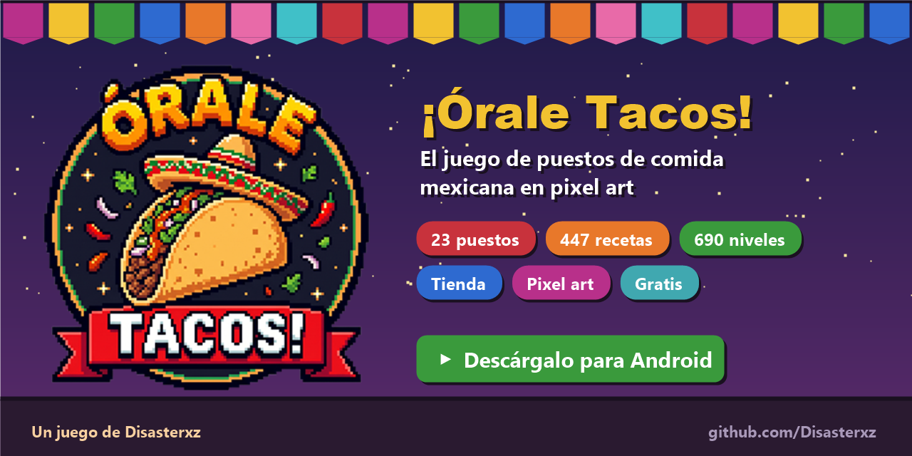
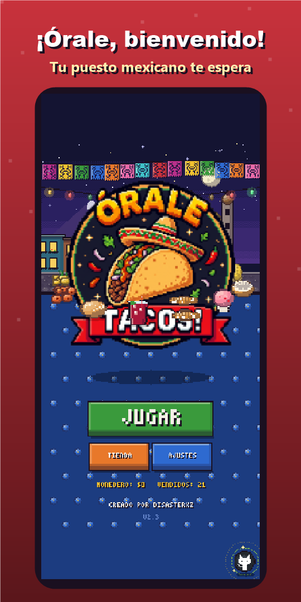
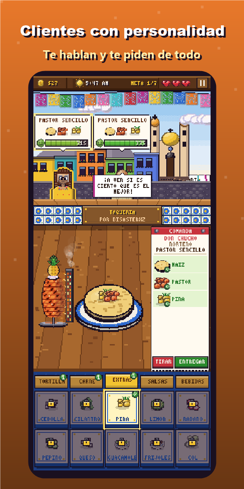
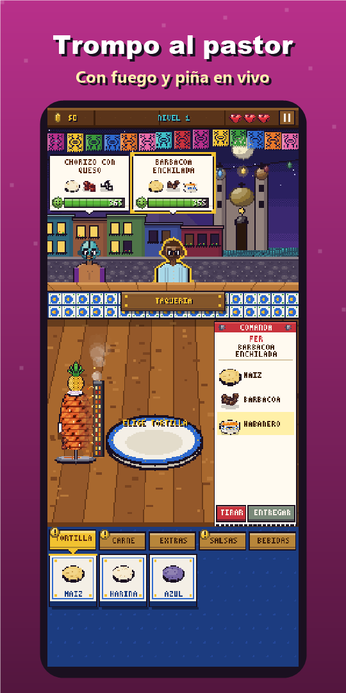
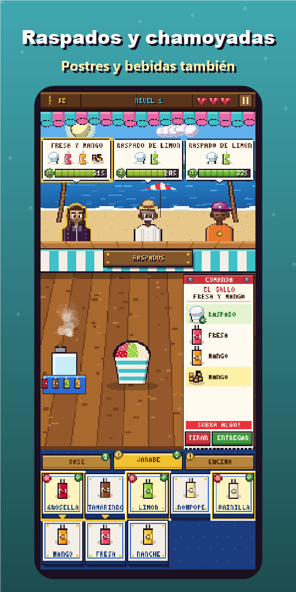
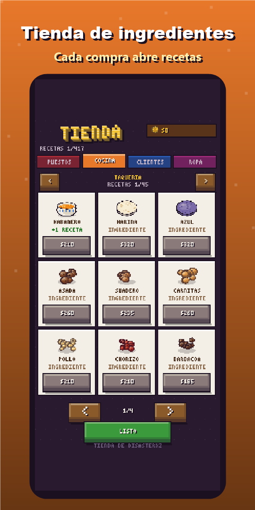

  

  

  
  
  
  
  
  

<b>Abre tu puesto a las 8 de la mañana, atiende a la clientela más chida de México y cierra a las 11 de la noche con la caja llena.</b>

---

## 🌮 ¿Qué es ¡Órale Tacos!?

**¡Órale Tacos!** es un juego de cocina rápida hecho **pixel por pixel**, inspirado en los puestos callejeros de México. Empiezas con una taquería humilde que solo sabe hacer **tacos de pastor sencillos**, y con lo que vendes vas comprando ingredientes, abriendo puestos nuevos y llenando tu barrio de clientes con personalidad: charros, catrinas, luchadores, abuelitas, mariachis, chefs y muchos más.

Cada cliente llega con su pedido, te habla, se desespera si tardas y te deja propina si lo atiendes bien. ¿Te equivocas? Le devuelves su dinero y pagas multa. ¿Tiras un taco? Pierdes los ingredientes. Como en la vida real, mi buen.

---

## 📸 Capturas

<table>
  <tr>
    <td></td>
    <td></td>
    <td></td>
  </tr>
  <tr>
    <td></td>
    <td></td>
    <td></td>
  </tr>
  <tr>
    <td></td>
    <td></td>
    <td></td>
  </tr>
  <tr>
    <td></td>
    <td></td>
    <td></td>
  </tr>
</table>

---

## ✨ Lo que vas a encontrar

| | |
|---|---|
| 🏪 **23 puestos** | Taquería, tamalería, tortería, mariscos, nevería, raspados, dulcería, dulces de feria y muchos más. |
| 📖 **447 recetas** | Desde un taco de pastor en tortilla de colores hasta una torta cubana, pan de muerto o ponche navideño. |
| 🧾 **Comanda guiada** | Cada pedido viene con su lista de ingredientes. Las flechas te dicen qué falta y la pestaña cambia sola al siguiente paso. |
| 🗣️ **Clientes que hablan** | Más de 100 frases bien mexicanas: amables, apurados, exigentes, bromistas, norteños, chilangos, tiernos, fresas y tímidos. |
| 🕗 **Un día completo** | El cielo pasa de la mañana al atardecer y a la noche. A las 11 PM se baja la cortina. |
| 💰 **Economía real** | Ganas por cada venta y por las propinas. Si tiras o te equivocas, pierdes dinero. |
| 🛒 **Tienda** | Compra puestos, ingredientes, nuevos clientes y ropa para tu clientela. |
| 🎯 **690 niveles** | 30 niveles por puesto en fácil, intermedio y difícil. ¡Complétalos en las tres dificultades para **platinarlos** y ganar un bono! |
| 📅 **Calendario mexicano** | El juego cambia según la fecha: Reyes, Amor y Amistad, Primavera, Día del Niño, Día de las Madres, Día del Maestro, Fiestas Patrias, Halloween, Día de Muertos, Revolución y Navidad, con decoración, música, personajes y platillos de temporada. |
| 🚨 **Eventos sorpresa** | Asaltos (¡hasta se pueden robar el trompo!), billetes falsos que revisas con el plumón detector y patrullas que llegan a ayudarte. |
| 🧔 **Don Chencho** | Un señor sin hogar que te pide un taquito. Si le ayudas, un día te lo paga. Tu **bondad** queda marcada. |
| 💵 **Billetes y monedas** | Tus clientes pagan con billetes y monedas mexicanas y ves el cambio. ¡Favor de traer cambio! |
| 🦗 **Visitas especiales** | Personajes misteriosos que aparecen sobre todo antes de cerrar... ¿los reconoces? |
| 🎨 **Pixel art animado** | Trompo de pastor girando con su piña y su fuego, vaporeras, ollas de barro, comales, garrafas y más. |
| 💡 **Consejos** | Tips cortos que aparecen sin interrumpir la partida. |
| 📱 **Pantalla completa** | Se adapta a cualquier teléfono o tablet, siempre en vertical. |

---

## 🗺️ Los puestos

| 🍽️ Comida | 🍿 Botanas | 🍰 Postres | 🥤 Bebidas |
|---|---|---|---|
| 🌮 Taquería | 🌽 Elotero | 🍠 Camotero | 🍹 Aguas Frescas |
| 🫔 Tamalería | 🥨 Botanero | 🍩 Churrería | 🥕 Jugos y Licuados |
| 🍲 Pozolería | 🍉 Frutería | 🥐 Pan de Canasta | |
| | | 🍬 Dulcería | |
| 🫓 Antojitos | | 🧇 Marquesitas y Crepas | |
| 🥖 Tortería | | 🍦 Nevería | |
| 🥩 Carnitas | | 🍧 Raspados | |
| 🍜 Birriería | | 🍭 Dulces de Feria | |
| 🍗 Al Carbón | | | |
| 🌭 Jochos y Burgers | | | |
| 🦐 Mariscos | | | |

---

## 🎮 Modos de juego

| Modo | ¿Cómo se juega? | Se desbloquea |
|---|---|---|
| 🟢 **Clásico** | Un día completo de 8 AM a 11 PM. Cumple la meta de ventas antes de cerrar. | Desde el inicio |
| 🟠 **Contrarreloj** | 90 segundos para vender todo lo que puedas. | Al pasar el nivel 3 |
| 🟣 **Maestro** | Solo ves el nombre del platillo y pagan el doble. ¡Sin ayudas! | Al pasar el nivel 6 |

---

## 💰 Así avanzas

1. Empiezas en la **taquería** con una sola receta: el **taco de pastor sencillo**.
2. Cada venta te da dinero y propina; al cerrar el puesto ves tu **resumen de ventas**.
3. En la **tienda** compras ingredientes: cada uno te dice cuántas recetas nuevas desbloquea.
4. Ahorra para abrir **nuevos puestos**, contratar **nuevos clientes** y comprar **ropa** para ellos.
5. Juega cada nivel en fácil, intermedio y difícil para **platinarlo**.
6. ¡Completa los 23 puestos y las 447 recetas!

> 💡 Los clientes te dan pistas: *"¿Cuándo va a traer suadero?"* o *"¡Debería vender gringas!"*. Hazles caso.

---

## 🗣️ Tu clientela

> **Doña Lupe (tierna):** *"Ay mijito, ¿cómo estás? Como los que hacía mi mamá."*
>
> **El Compa (norteño):** *"¡Quiubo, plebe! ¿Qué hay de bueno?"*
>
> **Memo (apurado):** *"¡Rapidito, que se me va el camión!"*
>
> **La Güera (fresa):** *"Osea, ¿tienen algo light?"*

17 tipos de clientes y más de 50 nombres distintos. ¡Casi nunca verás al mismo dos veces seguidas!

---

## 📲 Cómo instalarlo

1. Entra a **[Releases](../../releases/latest)** y descarga el archivo `.apk` más reciente.
2. Ábrelo en tu teléfono Android.
3. Si te lo pide, permite **"instalar apps de fuentes desconocidas"**.
4. ¡Listo! Abre **¡Órale Tacos!** y a vender.

**Requisitos:** Android 7.0 o superior. No necesita internet para jugar.

---

## 🔄 Actualizaciones automáticas

Cada vez que abres el juego, la pantalla de carga revisa si hay una versión nueva. Si la hay, el juego la descarga e instala desde aquí mismo: **siempre tendrás la versión más reciente**.

---

## ❓ Preguntas frecuentes

<b>¿El juego es gratis?</b>

Sí, es completamente gratis y no tiene anuncios.

<b>¿Necesito internet?</b>

No. Solo se usa internet para revisar si hay actualizaciones.

<b>¿Se pierde mi progreso al actualizar?</b>

No. Tu dinero, tus puestos, ingredientes, niveles y récords se conservan.

<b>¿Puedo cambiar la dificultad?</b>

Sí. En <b>Ajustes</b> puedes elegir Fácil, Normal o Difícil, además de música, sonidos, vibración, flechas de ayuda, efectos y consejos.

---

## 📝 Novedades

**v3.0**
- 📅 Calendario de festividades mexicanas con decoración, música, personajes y platillos de temporada.
- 🎯 30 niveles por puesto con dificultades y platino.
- 🍬 Nuevo puesto: Dulcería. 🌈 Tortillas de colores.
- 🚨 Asaltos, billetes falsos con plumón detector y llamadas a la policía.
- 🧔 Don Chencho y el indicador de bondad.
- 💵 Pagos con billetes y monedas mexicanas.
- 🦗 Visitas especiales y patrullas.
- 🐙 Botón de GitHub dentro del juego.

**v2.3**
- 🕗 Día completo: abres a las 8 AM y cierras a las 11 PM, con cielo de mañana, día, tarde y noche.
- 🚪 Animación de apertura y cierre con cortina o lona según el puesto.
- 🗣️ Clientes con personalidad que te hablan, se desesperan, te agradecen y te sugieren qué comprar.
- 💸 Mermas al tirar y devoluciones con multa al equivocarte.
- 🎯 Niveles con meta de ventas y resumen de ventas al cerrar.
- 🛒 Tienda con puestos, ingredientes, clientes y ropa.
- 🌮 Trompo de pastor con piña, cebolla, fuego y cuchillo animados.
- 💡 Consejos cortos durante la partida y nueva pestaña inteligente.

**v2.2** · Menú de ajustes, créditos, mejores indicadores y barra de paciencia.
**v2.1** · 22 puestos, 417 recetas y logo nuevo.
**v2.0** · Primera versión publicada.

---

   
  <b>¡Órale Tacos!</b> es un juego creado por <a href="https://github.com/Disasterxz"><b>Disasterxz</b></a>. 
  Hecho con cariño, pixel por pixel, en México 🇲🇽

