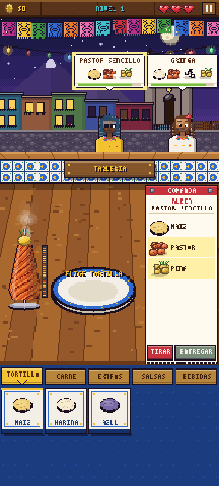
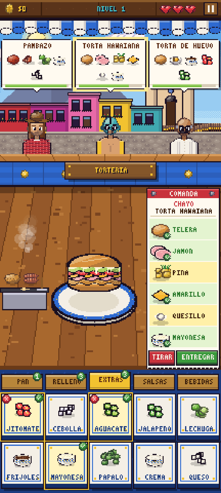

<h1 align="center">¡Órale Tacos!</h1>

Juego para Android inspirado en los puestos de comida mexicana, hecho en pixel art.

## Descargar

Descarga el APK más reciente desde **[Releases](../../releases/latest)** e instálalo en tu teléfono (activa "instalar apps de fuentes desconocidas").

El juego revisa si hay actualizaciones cada vez que se abre, en la pantalla de carga. Si hay una versión nueva, la actualización es obligatoria y se descarga desde el propio juego.

## Cómo se juega

- Llegan clientes con su pedido. La **comanda** te muestra lo que piden, paso a paso.
- Arma el platillo con los ingredientes; las flechas amarillas te señalan lo que falta.
- Toca **ENTREGAR** (o al cliente). Si lo sirves rápido, deja propina; 3 aciertos seguidos hacen combo.

### 22 puestos y 417 recetas
| Categoría | Puestos |
|---|---|
| Comida | Taquería, Tamalería, Pozolería, Antojitos (quesadillas, gorditas, sopes, huaraches, tlacoyos, molotes, empanadas, flautas), Tortería (tortas, ahogadas, cemitas, pambazos), Carnitas, Birriería (birria, quesabirria, barbacoa y consomé), Al Carbón (pollos, alitas, boneless, costillas, parrilladas), Jochos y Burgers (hot dogs, hamburguesas, banderillas, salchipulpos), Mariscos (cocteles, tostadas, aguachiles, pescadillas) |
| Botanas | Elotero (elotes, esquites, trolelotes, chaskas), Botanero (frituras preparadas, chicharrón de harina, papas, cacahuates, gomitas), Frutería (fruta con chile, vasos locos, cocteles con yogurt) |
| Postres | Camotero, Churrería (churros, donas, buñuelos, gorditas de nata, waffles, hot cakes), Pan de Canasta, Marquesitas y Crepas, Nevería (nieves de garrafa, paletas, esquimales), Raspados (raspados, diablitos, chamoyadas), Dulces de Feria (algodón, manzanas, palomitas, alegrías, arroz con leche, flan, gelatina, fresas con crema) |
| Bebidas | Aguas Frescas (aguas, tepache, tejuino, pozol, rusas y micheladas sin alcohol), Jugos y Licuados; además atoles, champurrado, café de olla y chocolate en sus puestos |

### Tipos de juego
- **Clásico**: 3 vidas; cada nivel llegan más clientes y recetas nuevas.
- **Contrarreloj**: 90 segundos para ganar lo más posible.
- **Maestro**: solo ves el nombre del platillo (usa el recetario) y pagan el doble.

## Capturas

